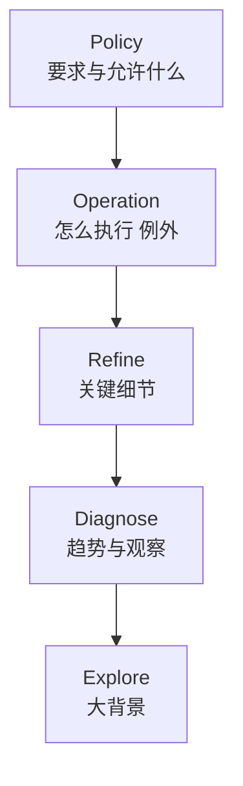

## Q
**Readable strategy docs · 把结论放最前**｜原则 · 加分

你写了一份很扎实的技术策略：从背景、诊断、分析一路写到结论，十五页。发给工程师后，没人照做，有人说"没看到明确的方向"。问题出在哪？

## A
**原则：** 写策略的顺序（explore → diagnose → refine → policy → operate）适合**想清楚**，不适合**被读**。多数读者只想知道政策和对自己的影响，读到一半就放弃了。所以发布时要**倒过来**：先写 policy 和 operation，再写支撑的细节。

**怎么做：**
1. **先分清写作目的：** 理清思路（学术式结构合适）、向高层求批准（读者关心具体方案）、向全组织传达政策（读者关心能做什么）。后两种要把结论放前面。
2. **倒序排布：** Policy、Operation、Refine、Diagnose、Explore。
3. **按读者关心的放最前：** 找高管批准就突出 Policy；推广给组织就突出 Operation。
4. **strategy refactoring：** 思考结束后把"思考工具"拆掉，例如把 Refine 并进 Diagnose，把 Operation 并到各项政策旁边。
5. **发布前找一个完全没参与的人读一遍**，让他指出看不懂的地方。
6. **明确的评论期和 office hours：** 既利于推广，也能找出反对者。
7. **模板里放元数据：** 创建日期、批准状态、在哪里提问（最重要，延长文档寿命）。
8. **发布后关闭文档内评论**，把讨论移到别处；一长串未解决的评论会让策略看起来没批准。

**常见错法：**
- **按思考顺序写，结论在最后。**
- **只给大图，没有操作方式：** 读者不知道例外怎么申请。
- **自己读一百遍觉得清楚：** 熟悉的人会忽略别人看不懂的地方。

**回到题目：** 把第一页换成三五条政策和例外流程，诊断和探索挪到后面，作为"想知道为什么的人再读"；找一位没参与的工程师通读；开两周评论期加一次 office hours。

面试官看什么 · 配哪类故事 · 出处

**面试官在考什么：** 你是否从读者角度写作，而不是从作者角度。

**适合配哪类故事：** 你把一份冗长的方案改成结论优先，使它被采纳或被正确执行的经历。

**出处：** Larson《Crafting Engineering Strategy》ch11 "Writing Readable Engineering Strategies"（Why Writing Structure Inhibits Reading；Inverting the Document Structure for Reading；Strategy Refactoring；Additional Tips）

