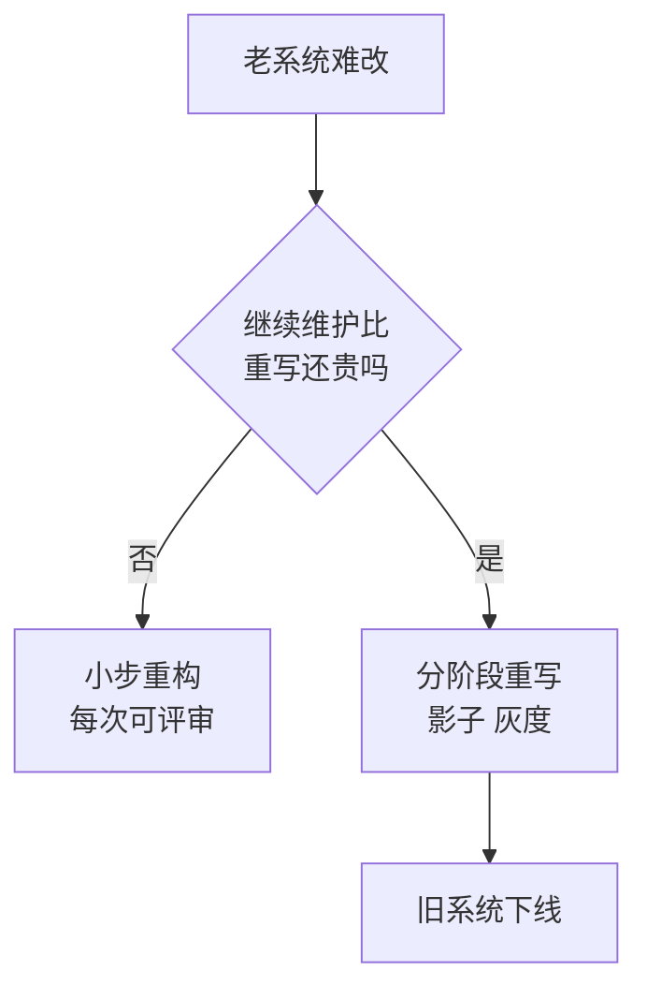

## Q
**Rewrite vs refactor · 重写还是重构**｜原则 · 加分

一个五年的老服务很难改，新同事提议"推倒重写，用新框架"，估计半年。你怎么评估？

## A
**原则：** 重写要**回退不了**："单向门"的标准是，反悔要做的工作**至少和实现时一样多**，"全部撤销再重写"就是这种。所以默认先走**小步重构**；只有当债已经让继续维护比重写更贵时，才考虑重写，而且要像迁移一样分阶段。

**怎么做：**
1. **先弄清是哪类债：** 代码债（重构能解决）还是架构债（服务边界、单体、框架过时）。后者可能需要重写部分。
2. **看"破产"条件：** Orosz 的说法是，tech debt 的"破产"点是删掉重写比继续修更便宜。没有到这一点，就先还一部分。
3. **重构的做法：** 先列出想改的清单并找有经验的人对一遍（有些丑陋是有意的取舍，如性能）；排序，简单的在前；每次一个小 PR，单独评审；规模失控就缩小范围。
4. **重写时同时重新考虑架构：** 例子：Khan Academy 从 Python 2 换到 Go，同时拆了单体、从 REST 改成 GraphQL。
5. **分阶段：** 用迁移的办法（影子、灰度、最后下线旧的），不要一次切换。
6. **用旧框架并不自动等于债：** 稳定、不时髦的语言和框架有"意外少"的好处。

**常见错法：**
- **因为"丑"就重写：** 没有算继续维护的成本和重写的风险。
- **边重写边加新功能：** 两条线都会拖慢。
- **从不重构：** 债的利息越滚越大。

**回到题目：** 先把"难改"拆开：具体哪些模块、每次改动多慢、事故多少。能通过重构解决的先做；如果决定重写，选一个边界清楚的模块先做，影子运行对比，再灰度。

面试官看什么 · 配哪类故事 · 出处

**面试官在考什么：** 你是否对重写保持怀疑，并有分阶段、可回退的方案。

**适合配哪类故事：** 你面对老系统，用小步重构或分阶段替换，而不是推倒重来，最终改善了可维护性的经历。

**出处：** Orosz《The Software Engineer's Guidebook》ch25 §3 "Architecture Debt"（#4 Dated languages or frameworks，Khan Academy 例）；§4（"Changes that lead to a full revert/rewrite"）；ch13 §3 "Tech Debt"（bankruptcy）；ch9 §3 "Refactoring"

