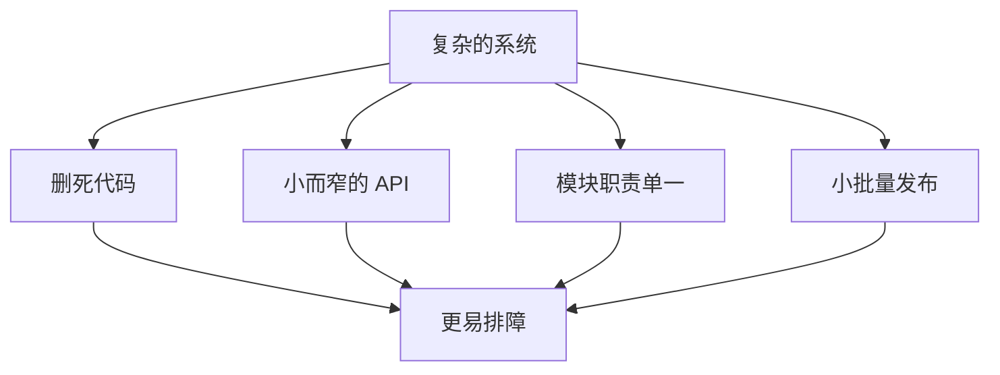

## Q
**Simplicity · 简单是可靠性的前提**｜原则 · 加分

你的服务里有一堆被特性开关关掉的旧代码、一个叫 `util` 的万能模块，每次发布都夹带几十个不相关的改动。线上出了性能问题，你花了两天才找到原因。你怎么改进？

## A
**原则：** 对一个一直在线的服务，**每多一行代码都是潜在的负债**。简单让系统更好理解、测试、维护和排障，所以简单是可靠性和敏捷性的前提，而不是它们的对立面。

**怎么做（Google SRE book，Simplicity 一章）：**
1. **区分 essential 与 accidental complexity：** 前者是问题固有的，后者可以消除；对后者要推回、清理。
2. **删代码：** 注释掉的代码令人困惑，被关掉的开关后面的休眠代码是隐患；版本控制让删除可逆；定期清除死代码。章节引用 Knight Capital 作为危险例子。
3. **Minimal APIs：** 小而简单的 API 通常说明问题被理解得清楚；拒绝承担某些问题，才能聚焦核心。
4. **Modularity：** 组件之间松耦合，职责窄；警惕 `util`、`misc` 这类万能模块；用版本化 API 让依赖方按自己的节奏升级。
5. **Release simplicity：** 一次发布夹带 100 个无关改动，出问题时很难找原因；小批量能衡量每个改动的效果。"简单的发布通常比复杂的发布好。"
6. **平衡稳定与敏捷：** 有过期时间的探索代码可以不走严格测试，因为它不进生产。

**常见错法：**
- **舍不得删代码：** 觉得以后可能用到。
- **用复杂换"灵活"：** 增加了没人需要的路径。
- **大批量发布：** 出事时无法定位。

**回到题目：** 一周内删掉关闭的开关后面的代码；把 `util` 拆成有明确职责的模块；发布改成每次只带一类改动并记录性能基线，下次出问题能马上定位。

面试官看什么 · 配哪类故事 · 出处

**面试官在考什么：** 你是否把简单当成设计目标，而不仅是审美。

**适合配哪类故事：** 你通过删代码、拆模块或缩小发布批次，让系统更可靠、排障更快的经历。

**出处：** Beyer 等《Site Reliability Engineering》"Simplicity"（sre.google/sre-book/simplicity/，2026-11-21 读取：System Stability vs. Agility；The Virtue of Boring；I Won't Give Up My Code；Minimal APIs；Modularity；Release Simplicity）

