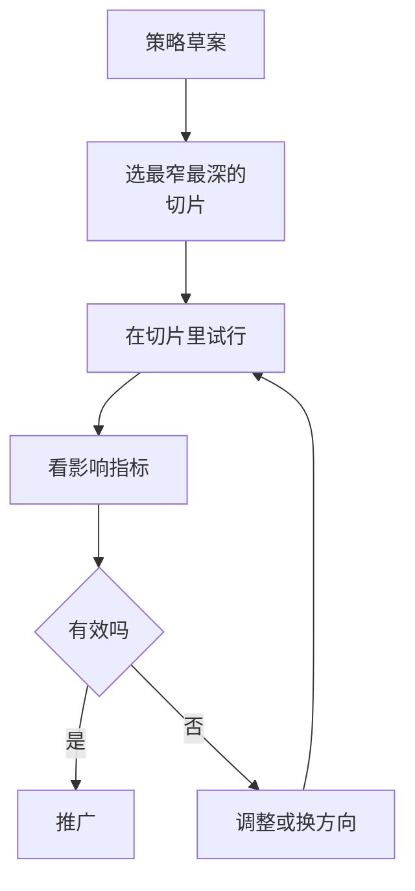

## Q
**Strategy testing · 先小范围试行**｜原则 · 加分

你定了一个新的发布流程策略，想下周起让所有团队都用。同事说"先别全推，会有很多细节问题"。你要怎么在推广之前验证它？

## A
**原则：** 过早全面推广会让你**无法判断策略是否有效**：压力下大家会装作遵守，实际尽量不变。更好的办法是**在小范围先测试**：选一个最窄、最深的切片，反复迭代直到确信细节可行。

**怎么做：**
1. **测试时机：** 在策略最终确定之前，聚焦底层机制，而不是动员推广。
2. **例子：** 整合收购的公司：先打通一个 API 集成；服务迁移：先迁一个最简单的组件（测试工具链）和一个最复杂的（测试集成复杂度）；新发布流程：先只做一次重要发布。
3. **指标衡量影响，而不是采用率：** 例如新流程是否降低了客户影响。
4. **假设大家是善意的：** 没人用工具，先假设是它太复杂，而不是对方抗拒改变。
5. **角色：** sponsor（提供组织权力、快速决策、争取支持）和 guide（日常协调验证）。
6. **不该做的：** 不要为了影响面感觉大而铺开（迭代更慢）；不要沉迷于强制采用而忽略改进机制；不要太执着于当前方案。
7. **什么时候可以不测：** 很便宜的宽松策略、无法测试的（如招聘地区调整，要运行数年才有信号）、极高把握（但作者对此持怀疑）。

**常见错法：**
- **瀑布式定稿后才推广。**
- **测试范围太宽：** 想一次解决激励冲突和推广问题。
- **看采用率不看效果。**

**回到题目：** 选一个团队做一次重要发布，用新流程；看发布造成的客户影响和耗时，而不是多少人用了；根据反馈调整，再扩大到第二个团队。

面试官看什么 · 配哪类故事 · 出处

**面试官在考什么：** 你推动变革时的方法论：先验证再推广，并关注摩擦。

**适合配哪类故事：** 你在大范围推广前用试点发现了关键问题，改进后推广成功的经历。

**出处：** Larson《Crafting Engineering Strategy》ch13 "Strategy Testing for Iterative Refinement"（When to Test Strategy；How to Test Strategy；Testing Roles: Sponsors and Guides）

