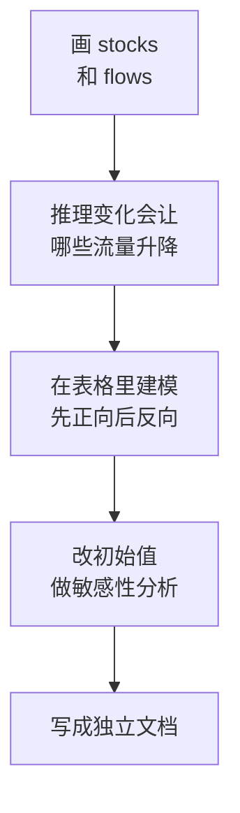

## Q
**Systems modeling · 用存量与流量推演**｜原则 · 加分

团队争论："让 AI 编码工具提高写代码速度，是不是就能多交付？"一方说是，另一方说"测试和线上问题会吃掉收益"。大家都靠直觉。你怎么让讨论有依据？

## A
**原则：** 把大家的直觉画成**存量（stock）和流量（flow）**的模型，在电子表格里跑，再看哪里是杠杆点。它让隐含的假设可被讨论，且比做真实实验快得多。

**怎么做：**
1. **何时有用：** 不知道杠杆点在哪；有大量数据可对照；干系人的分歧来自未说出口的直觉。
2. **步骤：** 在纸上或图工具里画 stocks 和 flows；推理一项改变会让哪些流量增减；在表格里建模（先 happy path 从左到右，再 exception path 从右到左）；用不同初始值试验，做 sensitivity analysis；写成独立文档并从策略里链接。
3. **找出反直觉的发现：** LLM 模型案例显示，如果线上发现的问题没有减少，缩短测试时间就没有净收益；另一个模型显示，提升司机入职速度对活跃司机的长期影响，不如重新召回已流失的司机。
4. **当它是推演工具，而不是现实：** 警告：模型与现实冲突时，现实永远是对的；每个模型都会遗漏信息，有时是关键信息；风险在于对模型过度自信。
5. **不适合：** 已经确定大方向、只需打磨细节时用 strategy testing（小范围试行）；想理解整个生态演变用 Wardley map（按演化阶段画能力的图）。

**常见错法：**
- **相信模型胜过现实。**
- **一上来就建很复杂的模型：** 先画简图。
- **只模型自己关心的部分：** 忽略迁移完成后的副作用。

**回到题目：** 画出需求→编码→测试→上线→线上问题→回修的流程，给每个环节设比率；改"编码速度"和"测试时间"，看已关闭工单数量如何变化；拿出模型一起讨论哪个假设最不可靠，再决定做什么试点。

面试官看什么 · 配哪类故事 · 出处

**面试官在考什么：** 你用结构化的方法处理争论和复杂系统，而不是凭感觉。

**适合配哪类故事：** 你用一个简单模型或估算，让团队摆脱直觉之争并发现了真正瓶颈的经历。

**出处：** Larson《Crafting Engineering Strategy》ch14 "Systems Modeling"（When Is Systems Modeling Useful?；How to Model；What Systems Modeling Isn't）；ch17 Document 17-2、17-4

