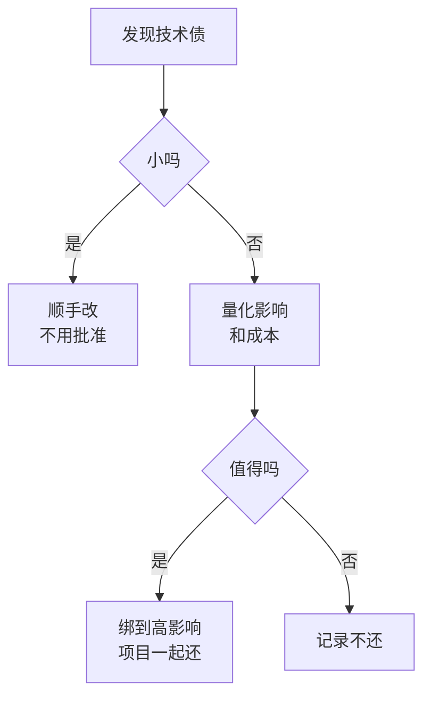

## Q
**Technical debt · 还不还、何时还**｜原则 · 必会

你们的构建每次要跑很久，几十个工程师每天都要跑好几次。团队里另一些人则嫌老代码里复制粘贴太多。经理问你："技术债这么多，你说先还哪个？不还会怎样？"

## A
**原则：** 技术债像贷款：用得好能加速，用不好利息很重。关键看**利息**，也就是它现在每天让多少人慢多少，而不是它"看起来多丑"。

**怎么做：**
1. 小的：边做边改，留下的代码比你接手时更干净。
2. 大的：盘点，量化影响和代价。例如慢构建的浪费 = 每次浪费的时间 × 每人每天跑几次 × 人数。
3. 看使用频率：高频使用的代码里还债收益大；快要下线的代码，大工程换小收益。
4. 提有明确影响的项目：可靠性、省成本、开发更快、bug 更少。
5. **绑定高影响项目：** 项目本来就要碰这块代码，就把清债作为项目的一部分，不另外申请。
6. 预防：代码易读、定期清理（用完的实验、过期的 feature flag、不再执行的路径）、系统留出扩展点。

**常见错法：**
- **一切债都要还：** 早期创业、原型、MVP 里的债是有意的，速度更重要；过早优化也会拖慢团队。
- **没有数据就争论：** 不量化，"债"只是个人偏好。
- **不记录：** 小的债没人追踪，累积到压垮。
- **把债当坏事：** 成熟的做法是把它看成速度与质量之间的取舍，放在项目目标里考虑。

**回到题目：** 先还构建慢：用"每次浪费时间 × 每天次数 × 工程师人数"算出每天的总浪费，对比修复需要几周，向经理提项目。复制粘贴的代码，如果在高频改动的模块里，就绑到下一个要改它的功能里一起提成共享库；在快废弃的模块里，记下来不碰。

面试官看什么 · 配哪类故事 · 出处

**面试官在考什么：** 你能否用影响和成本讨论技术债，而不是情绪。资深的信号是"不为还债而还债"。

**适合配哪类故事：** 你量化了一块技术债的影响，把它绑到一个高优先级项目里清掉，并让团队速度可见地变快的经历。

**出处：** Orosz《The Software Engineer's Guidebook》ch13 §3 "Tech Debt"（Paying down tech debt；Couple tech debt removal with high-impact projects；Reduce tech debt accumulation；"Just enough" tech debt）

