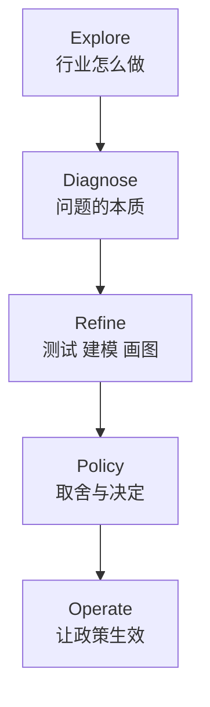

## Q
**Technical strategy · 诊断、政策、行动**｜原则 · 加分

CTO 让你为"微服务越来越多、没人管"这件事写一份技术策略。你手上有一堆想法，怎么把它们组织成一份真正的 strategy，而不是愿望清单？

## A
**原则：** 策略不是目标，也不是想法列表。Rumelt 说一个好策略有三根支柱：**diagnosis（诊断）**：对挑战本质的理论；**guiding policy（指导政策）**：一组应对挑战的通用政策，隐含取舍；**coherent actions（连贯行动）**：由政策指导的具体行动。Larson 把它变成五步：explore、diagnose、refine、set policy、operate。

**怎么做：**
1. **explore：** 先看别的公司和团队怎么处理类似问题，避免直接搬上家的做法。
2. **diagnose：** 先慢下来弄清问题，再谈解法；可以数据驱动（成本同比增长多少），也可以是已知与未知的总结。
3. **refine：** 用 strategy testing（小范围试行）、systems modeling（用存量与流量推演）、Wardley map（按演化阶段画能力的图）去验证原始想法。
4. **policy：** 做出取舍并说清规则。"如果政策不隐含取舍，要怀疑它"（"更努力地做"不是政策）。
5. **operate：** 把政策变成机制：提醒、周会、例外审批流程。
6. **别跳步：** 策略失败多半是因为可避免的错误，忙碌的人会跳过他们不喜欢的步骤。

**常见错法：**
- **只有目标没有诊断：** "提高可靠性"不是策略。
- **政策没有取舍：** 没有任何代价，也就没有选择。
- **写完就算了：** 没有 operate，政策只是一篇文章。

**回到题目：** 诊断：服务数量、归属不清、事故里有多少来自无主服务；政策："新服务需要审批，除非有显著不同的非功能需求；无主服务一季度内认领或合并"；操作：审批频道、每周看迁移进度、例外流程。

**面试官在考什么：** 你是否能把模糊的方向变成有诊断、有取舍、有落地机制的文件。

**适合配哪类故事：** 你主导了一份技术方向文件（标准化、迁移、治理），并通过机制让它真的被执行的经历。

**出处：** Larson《Crafting Engineering Strategy》ch1 "Adapting Rumelt for Engineering"（diagnosis / guiding policy / coherent actions）；ch5 "Steps to Build an Engineering Strategy"（五步与"别跳步"）；ch20 Document 20-1 Policy（决策对象示例）
