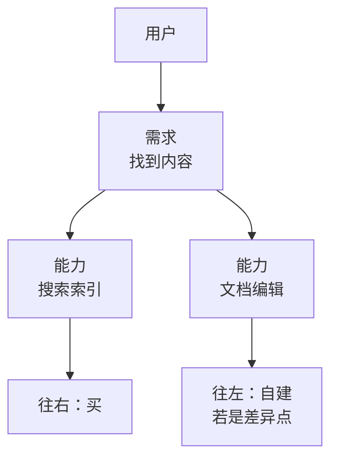

## Q
**Wardley maps · 该自建还是采购**｜原则 · 加分

你们的产品里有"文档搜索"和"文档编辑"两个能力，团队争论要不要自己做编辑器。怎么用一张图帮大家判断每个能力该自建还是买？

## A
**原则：** **Wardley map** 把能力按两个维度摆出来：纵轴是**对用户的可见度**，横轴是**演化阶段**：**genesis**（全新）、**custom**（需要专门的人构建和运维）、**product**（通常可以买到）、**commodity**（标准化到无人在意）。越往右越该买，越往左越可能是你要投入的差异化。

**怎么做：**
1. **从小做起：** 先选一两类用户。
2. **列出 users、needs、capabilities：** 用户连接需求，需求连接能力（能力不直接连用户）。
3. **连成 value chain：** 用户 → 需求 → 能力。
4. **放到地图上：** 上高下低表示可见度，左自定义、右商品化。
5. **看当下的图：** 哪里该集中注意力，哪些复杂度可以交给供应商。
6. **预测未来：** 画第二版，标出预期的演化（例如 AI 增强的文档编辑逐渐商品化），记下意外的含义。
7. **适用场景：** 环境变化快，需要 situational awareness（态势感知）；对优化某个漏斗的细节则不适合，用 systems modeling 或 strategy testing。

**常见错法：**
- **一开始画得太复杂：** 迷失在细节里。
- **只画现状：** 不预测演化，看不出自建的东西会不会被商品化。
- **当成最终答案：** 它帮助获得共同理解，不替代判断。

**回到题目：** 文档阅读已经商品化，用现成方案；文档搜索多半是 product；文档编辑在 product 与 custom 之间，若它是你的差异点才自建，否则采购或集成供应商，并预判 AI 编辑向右移动。

**面试官在考什么：** 你有没有一个系统的方法回答自建还是采购，而不是凭"我们能做"。

**适合配哪类故事：** 你用一张图让团队对哪些能力该买、哪些该自建达成共识的经历。

**出处：** Larson《Crafting Engineering Strategy》ch15 "Wardley Maps"（Components of a Wardley Map；X-axis；Y-axis；When Are Wardley Maps Useful?；How to Wardley Map）
