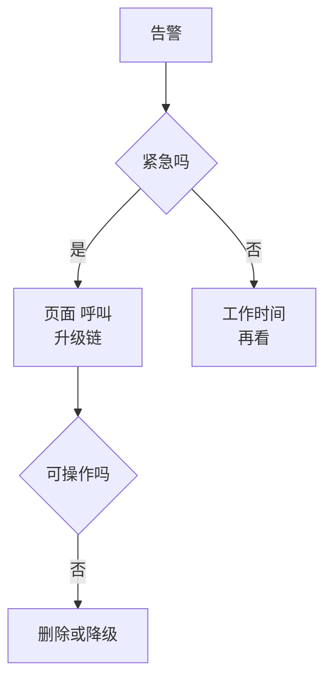

## Q
**Alert quality · 少而准的告警**｜原则 · 加分

你们的 on-call 每周被叫醒很多次，大多数告警一看就知道是误报；但上个月真的出了一次故障，却没有任何告警。怎么改告警？

## A
**原则：** 好告警要**可操作、症状导向、少噪声**。用 **precision**（告警里真问题的比例）和 **recall**（故障中有告警的比例）两个数同时看，因为砍噪声会降 recall，加告警会降 precision。

**怎么做：**
1. **选要报警的指标：** 问 "健康是什么样"、"以前出过哪些故障，哪些指标能预警"、"出问题时客户会注意到什么"；加 p95 一类百分位。
2. **分紧急程度：** 紧急告警推送、打电话、无人响应就沿指挥链升级；非紧急的不在下班后打扰人。
3. **好的页面（SRE book）：** 紧急、可操作、需要人动脑（机械的响应应该自动化）、新的问题。对症状多花精力，对原因的告警只在明确且迫近时用。
4. **创建规则时自问：** 它检测的是否是紧急、可操作、用户可见的情况？我会不会忽略它？它是否确定影响用户？我能采取行动吗？是否别人也被同一问题告警？
5. **量化：** 让 on-call 记录每条告警是否真是故障；复盘时问"故障前有告警吗"。例子：precision 30% 表示 10 条告警里只有 3 条是真故障；recall 30% 表示只有三成故障触发告警。
6. **静态阈值与异常检测：** 都要看经验判断。

**常见错法：**
- **按原因报警：** CPU 高就叫人，用户其实没受影响。
- **只砍噪声不看漏报。**
- **同一问题多人被叫：** 至少有一个页面是多余的。

**回到题目：** 统计上个月所有告警的 precision，把大量误报的告警降级或删除；对没有告警的那次故障加症状告警，如请求成功率下降；每月看 precision 和 recall。

面试官看什么 · 配哪类故事 · 出处

**面试官在考什么：** 你是否把告警当作需要度量和迭代的产品。

**适合配哪类故事：** 你通过减少噪声告警并补上盲区，使值班体验和故障发现速度同时改善的经历。

**出处：** Orosz《The Software Engineer's Guidebook》ch24 §4 "Alerting"（Urgency of alerts、Alert noise：precision / recall）；Beyer 等《Site Reliability Engineering》"Monitoring Distributed Systems"（sre.google/sre-book/monitoring-distributed-systems/：good pages、四个 golden signals、告警规则自问清单）

