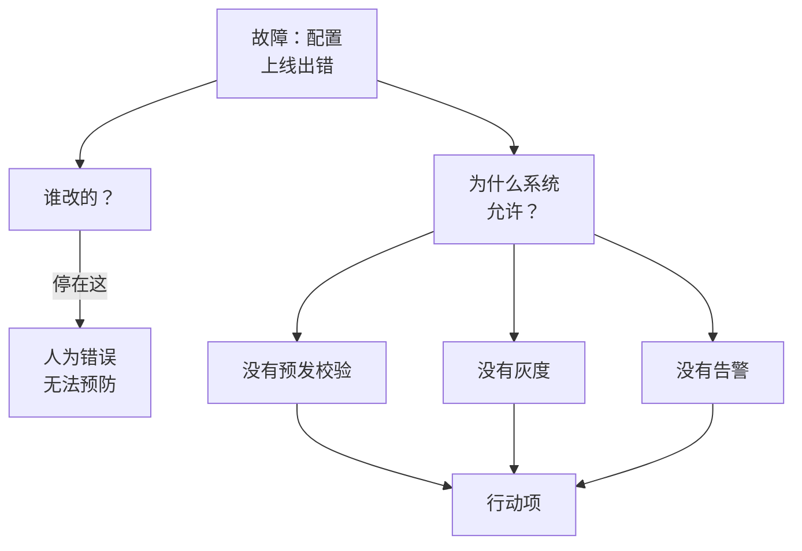

## Q
**Blameless postmortem · 不追人，追系统**｜原则 · 必会

一次故障原因是某位工程师改了一个配置，没有经过预发验证就上线了。复盘会上有人说："根因：人为错误，下次他要更小心。"你作为主持人怎么引导？

## A
**原则：** 复盘（postmortem，事后写成文字的故障记录）要找的是**让这个错误有可能发生、且没被拦住的系统条件**。你改不了人，但能改系统和流程。

| 一份复盘应包含 |
|---|
| 影响：谁受影响、多久、多严重 |
| 时间线：关键事件按时间排 |
| 缓解和解决的过程 |
| 根因和**贡献因素**（不止一个） |
| 行动项：预防再发的措施，有负责人和优先级 |

**怎么做：**
1. 假设每个人在当时都有善意，并且用手上的信息做了合理的事。
2. 问"系统为什么让这件事发生而没有反馈"，不是"谁干的"。
3. 事前定好触发条件：用户可见的宕机或降级超过阈值、任何数据丢失、值班工程师必须介入（回滚、改路由）、恢复时间超过阈值、监控没发现。
4. 初稿发给资深工程师评审：数据是否齐全、影响评估是否完整、根因是否够深、行动项优先级是否合适、有没有告知相关方。
5. 没有评审的复盘等于不存在；发布后放进团队知识库，让更多人读到。
6. 不让"频繁写复盘"成为污名；写得好的要被认可。

**常见错法：**
- **以"人为错误"作为根因：** 等于没有分析，下次换个人还是会发生。
- **只写不改：** 为了归档而写，没人读，也没人跟进行动项。
- **把"无责"当成"无人负责"：** 无责指不惩罚因不知情而出错的人；人仍要对修复负责。

**回到题目：** "他为什么能直接上线？我们缺哪一层验证？"把贡献因素列出来：没有预发校验、没有灰度、告警没有第一时间发现；每一个对应一个行动项，写明负责人和日期。

**面试官在考什么：** 你是否把故障当作改进系统的机会；是否理解"blameless"与"accountability"并不矛盾。

**适合配哪类故事：** 你主持或写过一份复盘，把一次事故推到了系统层面的改进，并真正落实了行动项的经历。

**出处：** Google SRE book《Postmortem Culture: Learning from Failure》（sre.google/sre-book/postmortem-culture/：postmortem triggers、blameless、review criteria）；Orosz《The Software Engineer's Guidebook》ch24 §6 #3 "Follow-up after an incident"（Blameless reviews）
