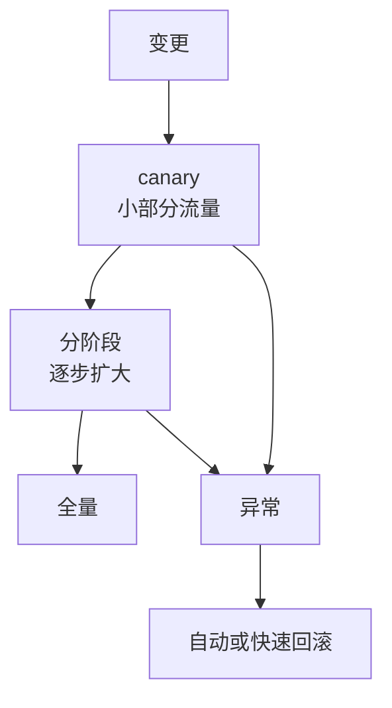

## Q
**Change risk · 变更是事故的主要来源**｜原则 · 加分

你要把一个配置改动推到全部线上服务器，评审的同事说"只是改个参数，没风险"。你怎么判断风险并安排发布？

## A
**原则：** 大多数事故来自**变更**（代码或配置），而且"看起来没风险"的变更常常最少被验证。控制变更风险靠**逐级暴露**：金丝雀、灰度、开关、能快速执行的回滚。

**怎么做：**
1. **明确哪些流程不能绕过：** 例如不测试直接强推、改生产数据库前不验证。成熟、有很多依赖用户的公司，打破规则前要三思，并先取得队友支持。
2. **canary：** 把变更先发给一小部分用户，监控健康信号。
3. **feature flag：** 把新逻辑藏在开关后面，对一部分用户开启；注意**过期开关**会污染代码，要有删除提醒。
4. **staged rollout：** 按比例或地区逐步推进，每一阶段设通过条件（无意外回归、业务指标符合预期）。
5. **回滚方案要容易执行**，尤其是数据和配置变更。
6. **给相关人提个醒：** 队友、依赖方的 on-call、客服、能看业务指标的人。
7. **发布后看客户反馈渠道。**
8. **用 error budget 决定能不能做有风险的发布：** 预算用完，就暂停高风险发布。
9. **SRE book 的教训：** 一次全球配置推送触发崩溃循环，因为变更"被认为没风险"，只做了较宽松的 canary，罕见的组合没被覆盖；教训是**无论看起来风险多低都要认真 canary**。

**常见错法：**
- **配置不当代码：** 同样会引起事故，却不走同等流程。
- **全量一次推：** 出事就是全部用户。
- **回滚没演练过。**

**回到题目：** 先 canary 到一小撮机器，看错误率和延迟，再按阶段扩大；写好回滚命令并演练；通知 on-call；"只改个参数"也走同样的路径。

面试官看什么 · 配哪类故事 · 出处

**面试官在考什么：** 你对发布风险是否有系统的防护意识。

**适合配哪类故事：** 你在一次高风险变更中用金丝雀或灰度提前发现问题并回滚，避免了事故的经历。

**出处：** Orosz《The Software Engineer's Guidebook》ch17 §4 "Additional Verification Layers"（#5 Canarying、#6 Feature flags、#7 Staged rollout、#9 Automated rollbacks）、§5 "Taking Pragmatic Risks"；Beyer 等《Site Reliability Engineering》"Emergency Response"（Change-Induced Emergency，sre.google/sre-book/emergency-response/）

