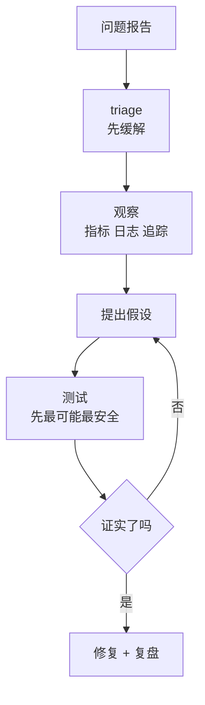

## Q
**Effective troubleshooting · 假设驱动排障**｜原则 · 加分

凌晨你被叫起来：服务延迟突然升高，没有发布也没有流量变化。你一个人面对一堆图表和日志。怎么排查才不会在里面兜圈子？

## A
**原则：** 排障是一个**假设—检验**循环：先观察、先理解系统怎么运作，提出假设，再用测试排除。**先止血，再找根因**；修复直接原因不必等根因分析或复盘。

**怎么做：**
1. **好的问题报告：** 期望行为、实际行为、怎么复现。
2. **triage：** 按影响决定做法；先缓解（切流量、限流、关掉子系统），保留证据，别在故障中优先查根因。
3. **examine：** 指标做起点，日志看一次操作做了什么，tracing 看请求如何穿过各组件，再看组件暴露的当前状态。
4. **diagnose：** 简化与缩小范围（给已知输入，逐个组件检查输出，或二分切路径）；问 what、where、why；问"最近谁动过它"：部署、配置、负载变化。
5. **test and treat：** 设计能排除假设的实验，先做最可能且最安全的；注意混杂因素和副作用（例如日志本身改变行为）；记带时间戳的笔记，改动要可回退。
6. **常见陷阱：** 追无关症状、误读指标；不安全地改系统；提不太可能的理论，忘了"听到蹄声想到马而不是斑马"；把相关当因果。
7. **负结果也有价值：** 它能排除方向、避免别人重复。
8. **让排障更容易：** 白盒指标、结构化日志、定义好的接口、请求 ID、受控且有记录的变更。

**常见错法：**
- **先找根因再缓解：** 故障时间被拉长。
- **同时改多个东西：** 无法知道哪个有效。
- **不记录：** 几小时后自己都忘了试过什么。

**回到题目：** 先缓解（加资源或切流量保住服务），保存日志；看指标和 trace 找延迟在哪个组件；检查最近的配置与负载变化；形成两三个假设，按"可能且安全"的顺序测试，每一步记下来。

**面试官在考什么：** 你的排障是否有方法，是否优先止血，而不是凭运气。

**适合配哪类故事：** 你用假设驱动的方法定位了一个难查的线上问题，并把方法沉淀成文档或工具的经历。

**出处：** Beyer 等《Site Reliability Engineering》"Effective Troubleshooting"（sre.google/sre-book/effective-troubleshooting/，2026-11-21 读取：Theory、In Practice：Problem Report/Triage/Examine/Diagnose/Test and Treat、Negative Results、Making Troubleshooting Easier）
