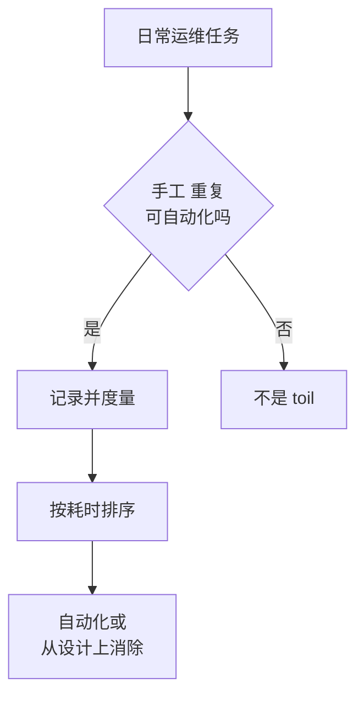

## Q
**Eliminating toil · 识别、度量、自动化**｜原则 · 加分

你们团队每周都有人手动重启卡住的任务、手动扩容、手动处理同样的工单，大家说"忙死了，没时间做项目"。你怎么判断这是不是 toil，怎么开始消除？

## A
**原则：** **toil** 是和运行生产服务相关的、**手工、重复、可自动化、被动、没有长期价值、随规模线性增长**的工作。不是每个特征都要满足。Google SRE 的目标是把 toil 压在每人时间的 **50% 以下**，其余用在能减少未来 toil 或增加功能的工程上。

**怎么做：**
1. **识别：** 对照六个特征：manual、repetitive、automatable、tactical、no enduring value、scales linearly。新颖的、第一次做的任务不算 toil；会议、HR 文书等是 overhead，不是 toil。需要大量人工判断也可能是 toil：糟糕设计的系统要求不断的人工判断，在重新设计前仍在产生 toil。
2. **度量：** 值班本身就设下了 toil 的下限：6 人轮值时，每 6 周有 2 周在值班（主加副），下限约 33%；8 人轮值约 25%。SRE book 说中断是 toil 的头号来源，其次是 on-call 响应，然后是发布。个体差异可能很大（0% 到 80%），可能意味着负担分配不均。
3. **优先级：** 先做耗时最多、最容易自动化的；每个自动化项目写清节省多少时间。
4. **从设计上消除：** 有时不是自动化，而是让这件事不再需要发生。
5. **为什么重要：** toil 太多会让个人停滞、士气低、倦怠；让团队失去工程身份、拖慢新功能、让开发团队把活甩给你们、让优秀的人离职。
6. **平均而不是每天：** 短期超标可以，长期明显偏离要重新评估。

**常见错法：**
- **用英雄主义扛：** 手动做得很熟练，却从不消除。
- **一次性大自动化：** 难以验证；先从小的、高频的做起。
- **把工作都叫 toil：** 有长期价值的"脏活"（如清理告警配置）不是 toil。

**回到题目：** 先用两周记录每个手动任务的次数和耗时，按总耗时排序；对前三名写自动化或设计消除方案，并向经理要保护的工程时间。

**面试官在考什么：** 你是否能把运维负担量化，并把时间投资到杠杆最高的自动化上。

**适合配哪类故事：** 你度量并自动化了一类重复运维工作，让团队腾出明显的时间的经历。

**出处：** Beyer 等《Site Reliability Engineering》"Eliminating Toil"（sre.google/sre-book/eliminating-toil/，2026-11-21 读取：Toil Defined、Why Less Toil Is Better、Calculating Toil、What Qualifies as Engineering?）
