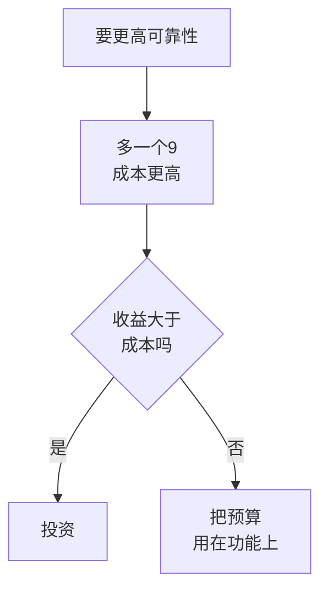

## Q
**Embracing risk · 为什么目标不是 100%**｜原则 · 加分

老板说："支付系统必须 100% 可用，一次都不能挂。"你怎么回应，并帮他选一个合理的可靠性目标？

## A
**原则：** 可靠性到了一定程度后，**越高反而对用户和服务有害**：拖慢功能、提高成本。用户往往感觉不到差别，每多一个 9 的成本还会陡增。目标应匹配**业务愿意承担的风险**，既是下限，也是上限。

**怎么做（Google SRE book）：**
1. **解释为什么不是 100%：** 用户在一个只有 99% 可靠的手机上，分辨不出服务是 99.99% 还是 99.999%；再多一个增量，成本可能是前一个的 100 倍（冗余资源，加上工程师没去做功能的机会成本）。
2. **用请求成功率度量可用性：** 对全球分布的服务，用滚动窗口里的请求成功率，而不是"整机在线时间"。例：每天 250 万请求、目标 99.99%，最多可有 250 个错误。
3. **算一笔账：** 一个年收入 100 万美元的服务，从 99.9% 到 99.99% 多出 0.09% 的可用性，价值约 900 美元；多一个 9 的成本低于它才值得。
4. **看失败的形状：** 偶尔图片加载失败体验差，但把私人联系人暴露给他人会毁掉信任，值得整个下线清理。
5. **基础设施服务分级：** 为不同客户提供明确的服务级别，让客户选最便宜且够用的。
6. **用 error budget 把争论变成共同指标：** 产品关心速度，SRE 关心可靠性；SLO 与实际之间的差距就是预算，预算还有就能发布，快用完就放慢。

**常见错法：**
- **100% 目标：** 无限成本，且没有人能达到。
- **不看用户：** 在用户感知不到的地方投资。
- **目标与预算脱钩：** 数字写在文档里，决策不参考。

**回到题目：** "100% 买不到。我们按支付成功率设 SLO，比如 99.9%，并算多一个 9 要多少人力和多久的功能延迟，对比业务损失；预算用完时暂停高风险发布。"

面试官看什么 · 配哪类故事 · 出处

**面试官在考什么：** 你是否能把可靠性当成有成本的权衡来讨论。

**适合配哪类故事：** 你为一个服务定下合理的可靠性目标，把"越高越好"的诉求变成成本收益讨论的经历。

**出处：** Beyer 等《Site Reliability Engineering》"Embracing Risk"（sre.google/sre-book/embracing-risk/，2026-11-21 读取：Managing Risk、Measuring Service Risk、Risk Tolerance of Services、Motivation for Error Budgets）；与 SLO 的关系见同 deck 的 SLOs & error budgets

