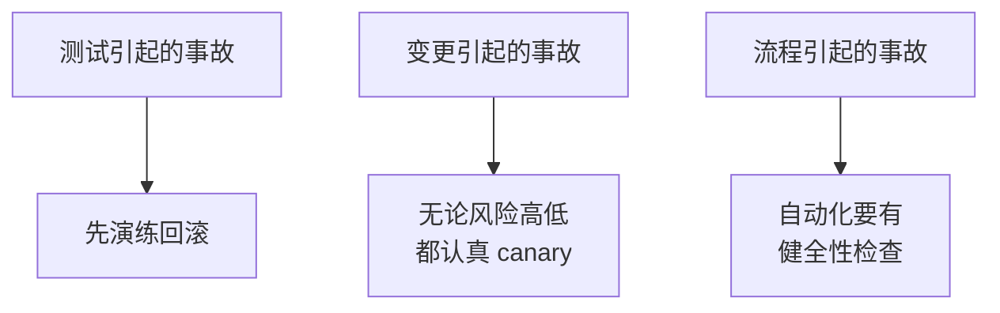

## Q
**Emergency response · 从故障案例学什么**｜原则 · 加分

你负责一次有风险的操作：把一批机器下线。同事问："万一出事怎么办？"面试官也问你，从别人的事故里你学到了什么、怎么提前做准备？

## A
**原则：** 紧急事件的经验：**先止血、保持冷静、叫人帮忙、记录失败模式、测试修复**；而且**事前**要演练回滚和事故流程，因为事故里临时现学最慢。

**三个案例（SRE book）与教训：**
| 类型 | 发生了什么 | 教训 |
|---|---|---|
| test-induced | 为找隐藏依赖，计划屏蔽一百个数据库中的一个，几分钟内依赖方报告用户无法访问。一小时内恢复。没按事故流程走（流程刚引入几周、没传达），回滚从没在测试环境演练过 | 大规模测试前先测试回滚；让事故响应流程清晰传达 |
| change-induced | 周五全球推送一个配置，触发崩溃循环，几乎整个外部服务器同时崩。推送者在看实时频道，5 分钟内回滚；10 分钟内宣布事故。告警反复轰炸；自家排障工具依赖崩溃的服务。因为变更"不被认为有风险"，canary 较松 | 无论感知风险如何都认真 canary；熟悉并演练备用访问方式 |
| process-induced | 自动化测试中，同一个下线请求提交两次；自动化的 bug 把全球所有安装的机器送去擦盘。大型安装不受影响。空响应被当成"所有机器" | 自动化要对发出的命令做健全性检查；"有时零就是全部"；恢复基础设施要为异常负载调优 |

**怎么做：**
1. **准备：** 事前演练回滚和事故响应；知道备用访问通道。
2. **响应时：** 保持冷静，叫人帮忙，记录失败模式。
3. **善后：** 把教训变成流程和系统改进。

**常见错法：**
- **跳过事故流程：** 因为"这只是个测试"。
- **以为低风险变更不需要 canary。**
- **自动化没有保护：** 空输入变成全选。

**回到题目：** 在做下线前：演练回滚，设置只影响小批量的限制，加一条"空列表则中止"的检查，明确谁是指挥、在哪个频道通报，并确认有不依赖被操作系统的备用访问方式。

面试官看什么 · 配哪类故事 · 出处

**面试官在考什么：** 你从别人的事故里提取原则、并提前准备的习惯。

**适合配哪类故事：** 你在做高风险操作前主动演练回滚、加保护，从而避免或快速恢复事故的经历。

**出处：** Beyer 等《Site Reliability Engineering》"Emergency Response"（sre.google/sre-book/emergency-response/，2026-11-21 读取：Test-Induced、Change-Induced、Process-Induced Emergency；Lessons Learned 与"All Incidents Should Be Novel"）

