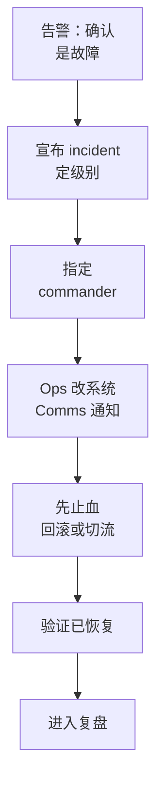

## Q
**Incident command · 先止血，分角色**｜原则 · 必会

周四下午两点，你是值班工程师，告警显示一个机房停止服务，十分钟内第二个机房也挂了。你一个人在翻日志，三位同事在群里说"我先看看"，副总开始问预计恢复时间。你怎么把局面稳住？

## A
**原则：** 事故里最大的敌人是**一个人盯着技术问题，没人沟通、各人自己改线上**。先把角色分开，目标是**尽快恢复服务**，找原因放后面。

| 角色 | 职责 |
|---|---|
| Incident commander | 掌握整体状态，分配角色；没分出去的职位默认由他兼 |
| Ops lead | 用运维手段改系统；事故期间**只有他们**改线上 |
| Communications | 对外的窗口：定期给团队和干系人发更新，维护事故文档 |
| Planning | 处理长期的事：提 bug、安排交接、记录系统偏离了正常多少，事后要恢复 |

**怎么做：**
1. 尽早宣布 incident，指定 commander。commander 不一定是发现的人；"你来当 commander 好吗"并且对方明确答应。
2. commander 的首要任务是维护一份**实时事故文档**，所有人都读它。
3. 有已知的缓解办法就立刻做（比如回滚最近的改动），**不要等查清原因**；不知道时拉有关专家。
4. 做完后验证是否真的缓解；缓解动作有时会让事情更糟。
5. 通知干系人，不让他们来问值班的人。
6. 跨时区或跨天时明确交接："你现在是 commander，好吗？"对方确认后才离开。

**常见错法：**
- **一个人身兼数职：** 技术和沟通都做不好。
- **freelancing：** 好心的同事没打招呼就改线上，让情况更糟。
- **先找根因再动手：** 能回滚就先回滚，原因之后有的是时间查。
- **等到问题拖了几小时才启动流程：** 宁可早宣布，修好就关。

**回到题目：** 先找一位同事接 commander，你转为 Ops 继续排查；告诉另外两位："听 Ops 安排，做任何改动先说"。让 commander 发一封邮件给副总和相关方，之后按固定节奏更新，副总就不必来问你。你的任务只剩止血：回滚上一个版本、切流量、扩容，哪个有用做哪个。

面试官看什么 · 配哪类故事 · 出处

**面试官在考什么：** 你在压力下是否先建立秩序和沟通，而不是自己一头扎进代码；知道"先止血、后找因"。

**适合配哪类故事：** 你在一次严重事故中承担了协调或指挥的角色，把混乱变成有序、更快恢复的经历。

**出处：** Orosz《The Software Engineer's Guidebook》ch24 §6 "Incident Management"（#2 Fix it：roles、mitigation、"Assessing the root cause … isn't the biggest priority"）；Google SRE book《Managing Incidents》（sre.google/sre-book/managing-incidents/：roles、live incident state document、clear live handoff）

