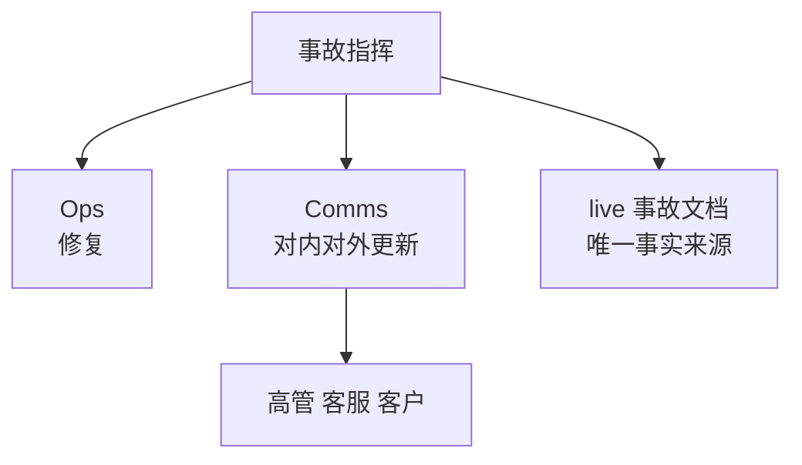

## Q
**Incident communication · 事故中怎么沟通**｜原则 · 加分

线上支付故障已经二十分钟，原因还不清楚。VP 在群里问进展，客服问怎么回复客户，工程师们在好几个频道里各说各的。你是 incident commander，怎么处理沟通？

## A
**原则：** 事故时沟通要**有专人负责、集中一处、定时更新**。工程师专心修，通讯由 communications 角色负责；不确定时说"已知、未知、下次更新时间"，不猜原因。

**怎么做：**
1. **角色清楚：** 角色：commander 协调，Ops 动系统，Comms 是"事故响应的对外窗口"，负责定期给响应团队和相关方发更新（常用邮件），也可以负责保持事故文档准确。
2. **一份 live 事故文档：** commander 保持一份可多人同时编辑的文档，"可以乱，但必须可用"，事后复盘也要用它。
3. **一个可以找到 commander 的地方：** 例如 war room 或固定频道，相关方知道在哪里互动；高管用邮件线程掌握概况，不被细节淹没。
4. **交接要明确：** 一天结束换班时说"你现在是 commander，好吗？"并等对方明确确认再离开。
5. **不确定时怎么说（通用做法）：** 写三件事：已确认的影响、还不知道的、下一次更新时间。别把猜测当结论，别承诺修复时间。
6. **外部沟通：** 让专门的外部沟通代表起草用户信息，不让修复的工程师分心。
7. **更新节奏：** 与相关方事先约定，严重程度越高越频繁；按约定的时间发，哪怕只是"无新进展"。

**常见错法：**
- **修的人同时回答所有人：** 修复变慢，信息还不一致。
- **多个频道各说各的：** 没有事实来源。
- **沉默到有结论：** 相关方只能自己猜，升级压力更大。

**回到题目：** 指定一个人做 Comms；在一个频道和一份文档里集中信息；对 VP 和客服发第一条更新：影响、已知/未知、下次更新时间；之后按时更新。

**面试官在考什么：** 你在压力下是否能让信息有秩序，并理解沟通是事故响应的一部分。

**适合配哪类故事：** 你在一次事故中承担沟通或指挥角色，让团队和相关方都保持同步的经历。

**出处：** Beyer 等《Site Reliability Engineering》"Managing Incidents"（sre.google/sre-book/managing-incidents/，2026-11-21 读取：Communications、live incident document、handoff）；Orosz《The Software Engineer's Guidebook》ch24 §6（"Communicate with stakeholders"、roles）；"已知/未知/下次更新" 的措辞是通用做法，该书没有给模板
