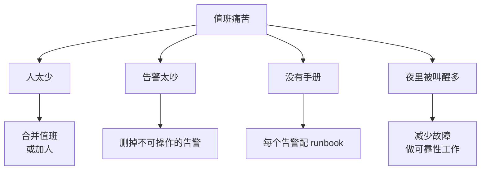

## Q
**On-call practice · 可持续的值班**｜原则 · 必会

你们团队三个人，每人每三周值一次班，一周里经常半夜被叫醒，其中一半告警都不用处理。有位同事说想调组。你要怎么改善值班？

## A
**原则：** 值班要**可持续**：人数够、告警有用、有手册、交接清楚。糟糕的值班会让人离职，和糟糕的经理一样。

**怎么做：**
1. **人数：** 一般每人值一周。至少 5 人才能保证每人每月最多一次；6 人更稳，能吸收节假日和病假。若再设副值班，健康的轮值约 10–12 人。团队太小，就和相近领域的团队合并值班。
2. **runbook：** 每个告警附上手册：诊断步骤（看哪些面板和指标）、缓解办法、以前出现过的相关事故。每次事故后检查并更新手册。
3. **告警质量：** 告警要对应威胁 SLO 的症状，而且都**可操作**；每小时都来打扰的低优告警会让人疲劳，对严重告警反而不上心。
4. **负载：** 值班时的"正常工作"怎么算要明说：不做项目、或默认零产能、或按一个比例，但值班负载不可预测，别硬派任务。
5. **烧尽的信号：** 一个月值班超过一次、告警吵、一周被叫醒超过一次、故障多、值班时还要做正常工作；这些叠加就要出手。
6. 目标可量化：例如每班页面数、每日工单数有上限。

**常见错法：**
- **用人硬扛：** 轮值人数不够，靠个人牺牲。
- **只修告警不修系统：** 噪音少了，根因没解决，故障还是多。
- **手册写完就不管：** 过期的手册比没有还误导人。

**回到题目：** 先和另一个相近团队合并值班，人数到 6 人以上；把一半不可操作的告警删掉或降级；给剩下的告警补 runbook；统计半夜被叫醒的次数，作为后续可靠性工作的依据，向经理要时间。

面试官看什么 · 配哪类故事 · 出处

**面试官在考什么：** 你对运维负担的整体视角：不仅能值班，还会改进值班本身。

**适合配哪类故事：** 你改善了值班（减噪音、写手册、调整人数），让团队负担明显下降的经历。

**出处：** Orosz《The Software Engineer's Guidebook》ch24 §5 "Oncall"（Typical oncall rotations、Oncall runbooks、Should engineers do normal work while oncall、Oncall burnout）；Google SRE book《Being On-Call》（sre.google/sre-book/being-on-call/：Operational Overload）

