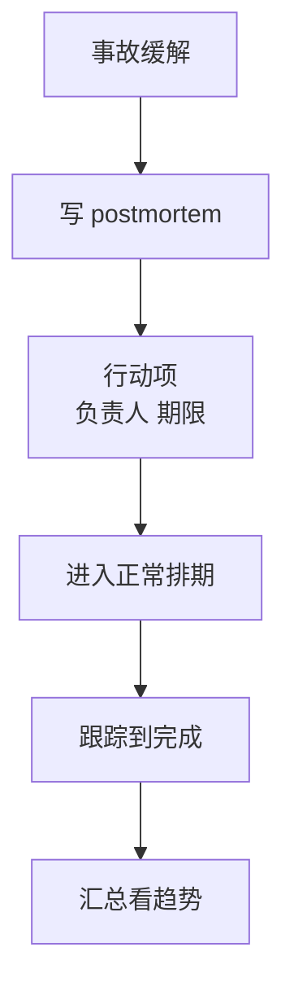

## Q
**Postmortem action items · 为什么复盘没用**｜原则 · 加分

你们每次事故后都写 postmortem、列行动项，但三个月后同类事故又来了，去看上次的行动项，一半没人动过。怎么让复盘真的有效？

## A
**原则：** 复盘的目的是**防止再发**，不是写文档。行动项最容易在缓解之后被降级，特别是需要大量工程工作的。让它有效要靠：行动项有**负责人、期限、被跟踪**，并且你要为团队**争取做这些事的时间**。

**怎么做：**
1. **行动项要具体：** 能降低复发可能性或影响，写清谁来做、什么时候，放进团队正常的跟踪系统。
2. **审查行动计划：** SRE book 的复盘由资深工程师评审，检查行动计划是否合适、相应的 bug 修复是否优先级得当。
3. **别让它被淹没：** Orosz 的原话方向：缓解后很容易被降级，尤其工作量大的；作为 staff+，你要创造时间，有时甚至要牺牲其他任务。
4. **看趋势：** 汇总多个 postmortem，加元数据，找出重复主题。
5. **未评审的复盘等于没写：** "An unreviewed postmortem might as well never have existed."
6. **为学习而写，而不是为归档：** Allspaw 的观察：大多数事故报告是为了被归档，而不是被阅读和学习。

**常见错法：**
- **行动项没有负责人和期限：** 默认没人做。
- **只写表面修复：** 例如"加一个告警"，没有触及让变更无反馈地上线的条件。
- **写完就关：** 没有评审，没有后续跟踪。

**回到题目：** 先把上次的行动项逐条认领或明确放弃；之后每个行动项必须有负责人和日期，进入季度排期；每月看一次未完成的；把相同根因的事故合并分析。

**面试官在考什么：** 你是否对结果负责，而不只是执行流程。

**适合配哪类故事：** 你推动一批事故行动项真正完成，并用数据证明同类事故减少的经历。

**出处：** Orosz《The Software Engineer's Guidebook》ch24 §6 "Incident follow-up actions"、"Consider whether your incident review process prioritizes learning"（引 Allspaw）；Beyer 等《Site Reliability Engineering》"Postmortem Culture"（sre.google/sre-book/postmortem-culture/：preventive actions、review、"An unreviewed postmortem might as well never have existed"；该章对行动项的后续跟踪描述不多，"负责人加期限"是通用做法）
