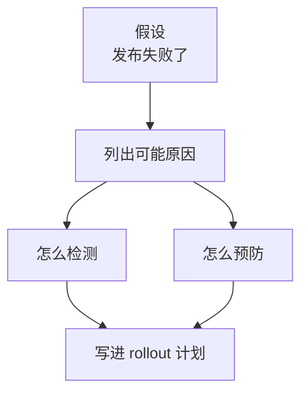

## Q
**Pre-mortems · 事前验尸**｜原则 · 加分

下个月你们要把核心订单数据迁到新数据库，大家都很乐观。你想在开始前做一个 pre-mortem。怎么做，会问出什么？

## A
**原则：** pre-mortem 是**假设项目已经失败，再倒推原因**。它让大家有理由说出平时不好意思说的担心，并且在改动还便宜时找到检测办法和预防措施。

**怎么做：**
1. **开会前设定：** "三个月后迁移出了严重问题，是怎么发生的？"每个人先独立写下原因。
2. **汇总归类：** 数据、依赖、容量、人、流程。
3. **对每个原因回答两件事：** 怎么发现（监控、对比）、怎么预防（测试、灰度、回滚）。
4. **接入 rollout 计划：** 量化 rollout 的含义（新旧系统使用量、性能、业务指标）；定义阶段与"健康"的判断；定义足够的 bake 时间；准备回滚方案，数据和 schema 变更时更难。
5. **结合其他练习：** 模拟故障，验证降级、重试退避、熔断（circuit breaker）、机房切换和灾难恢复。
6. **把结果写下来：** 进 design doc 的"风险"一节，指定负责人。

**常见错法：**
- **走过场：** 只列大家都知道的风险。
- **没有后续动作：** 只列清单，没有检测和预防。
- **只说技术风险：** 忽略依赖团队、人员、时间。

**回到题目：** 开一次会：假设迁移失败，写原因：双写不一致、容量、回滚不了、某个依赖团队没准备好；为每一项写检测和预防，并并入迁移的 rollout 计划。

面试官看什么 · 配哪类故事 · 出处

**面试官在考什么：** 你是否主动、系统地找风险，而不是等事故。

**适合配哪类故事：** 你在大变更前做了风险推演，提前发现并堵住了一个关键漏洞的经历。

**出处：** Orosz《The Software Engineer's Guidebook》ch15 §4 "Software Architecture That Ships"（"Do a 'pre-mortem' exercise"；Quantify the rollout、Have a rollout plan、time to bake、rollback plan）；ch24 §7 "Building Resilient Systems"（Simulate failures）；会议具体做法为通用实践

