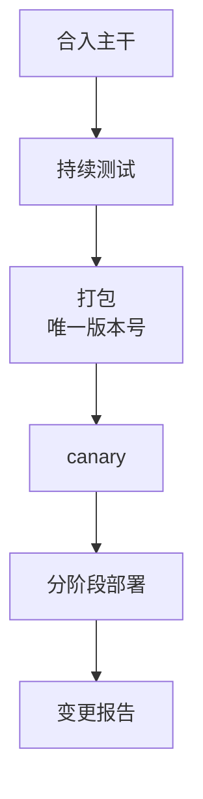

## Q
**Release engineering · 可重复的发布流程**｜原则 · 加分

你们每次发布都靠某位老工程师在自己的机器上跑一串命令，换一个人就出错，也没法重建三个月前的那个版本。怎么把发布做成可靠的流程？

## A
**原则：** 可靠的服务需要**可靠、可重复、自动化**的发布流程，不能有"独一无二的雪花"。Google 的发布工程哲学：**self-service、高频发布、hermetic build、策略强制**。

**怎么做：**
1. **self-service：** 各团队自己运行发布流程，发布基本自动，只有出问题才需要人。
2. **高频：** 频繁发布意味着两版之间改动少，测试和排障都更容易；有的团队每小时构建，有的"绿了就推"（Push on Green）。
3. **hermetic build：** 构建结果不依赖机器上装了什么；工具和依赖版本固定；需要时在原始版本上重建旧发布，用 cherry pick 加修复。
4. **强制策略：** 对源码改动、发布动作、部署、cherry pick 的访问控制；几乎所有改动要代码评审；每次发布产出变更报告以辅助排障。
5. **分支：** 从主干切发布分支；修复先进主干再 cherry pick；分支不合回主干，所以发布的内容永远清楚。
6. **测试：** 主干持续测试；从最后一个全部通过的版本构建发布；在发布分支重跑单元测试留下审计记录。
7. **部署匹配风险：** 预生产可自动推；大型面向用户服务逐集群指数扩大；敏感基础设施可能分多天跨地区推。
8. **配置管理：** 也进主仓库、严格评审；四种模式：主干配置、随二进制打包、单独配置包、外部存储。
9. **尽早做：** 项目一开始就考虑发布工程，事后补救更贵；开发、SRE、发布工程协作，不要"扔过墙"。

**常见错法：**
- **发布靠个人：** 无法重复。
- **构建不 hermetic：** 同一版本在不同机器结果不同。
- **配置不受控：** 配置改动绕过评审。

**回到题目：** 先把发布步骤写成脚本并版本化，再让 CI 在干净环境里构建、打唯一版本号；让每个人（不是某一位）一键发布；保留变更报告以便回溯。

面试官看什么 · 配哪类故事 · 出处

**面试官在考什么：** 你是否理解发布是工程问题，而非手工活。

**适合配哪类故事：** 你把一个手工、依赖个人的发布流程变成自动、可重复流程的经历。

**出处：** Beyer 等《Site Reliability Engineering》"Release Engineering"（sre.google/sre-book/release-engineering/，2026-11-21 读取：The Role of a Release Engineer、Philosophy、Continuous Build and Deployment、Configuration Management、Key Lessons）；与 Change risk 一卡互补（偏流程与工具）

