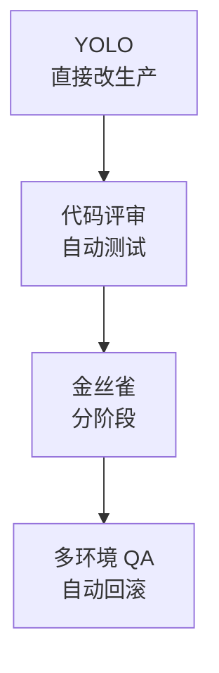

## Q
**Release spectrum · 按风险选发布方式**｜原则 · 加分

团队里有人想"直接 SSH 上去改，最快"，也有人坚持每次改动要走五个环境和 QA 签字。两边都有道理。你怎么选发布方式？

## A
**原则：** 发布方式是一条**谱**：一端是 **YOLO 发布**（直接在生产改），最快但没有安全网；另一端是**多阶段彻底验证**，最慢也最稳。按**产品风险和用户规模**选，而不是二选一。

**怎么做：**
1. **YOLO 的适用：** 副项目、没有客户的早期创业、紧急事故（尤其没有成熟事故流程的地方）。用户越多，越不能这样。
2. **典型组合：** 创业公司、传统公司、大型科技公司各有不同；多数团队用一部分手段，很少全用；有的手段互相抵消，例如有 multi-tenancy 时不太需要多个测试环境。
3. **选择问题：** 愿意在现代工具上投入多少？业务能承受多大 error budget？目标迭代速度是多少？QA 团队的主要目的是什么？遗留代码多不多？
4. **有节制地冒险：** 决定哪个流程不能绕过；对相关方提个醒；有回滚方案；发布后看客户反馈；跟踪事故；用 error budget 决定能否做高风险发布。
5. **投资的方向：** 更快的迭代意味着更早发现问题；自动化的分阶段发布和回滚让工程师"不怕动生产"。

**常见错法：**
- **一刀切：** 对所有服务用同样的重流程，或同样的轻流程。
- **紧急时全部绕过：** 事故里 YOLO 最容易造成二次事故。
- **以为越多关卡越安全：** 关卡多但验证低价值，只是拖慢。

**回到题目：** 按风险分级：内部小工具走轻流程；支付链路走 canary、staged rollout 和自动回滚；紧急修复也要至少一人评审和回滚方案。

面试官看什么 · 配哪类故事 · 出处

**面试官在考什么：** 你理解发布速度与风险的取舍，能按情境选择。

**适合配哪类故事：** 你为不同风险的服务设计了差异化的发布流程，提升速度同时降低事故的经历。

**出处：** Orosz《The Software Engineer's Guidebook》ch17 §1 "Extremes in Shipping to Production"、§2 "Typical Shipping Processes"、§5 "Taking Pragmatic Risks"、§7 "Selecting an Approach"

