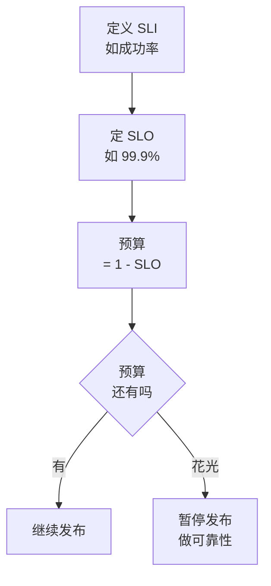

## Q
**SLOs & error budgets · 用预算谈发布**｜原则 · 必会

产品想每天发布新功能，运维担心稳定性，每次发布都吵一架。你怎么让两边用数据而不是情绪来决定"能不能发"？

## A
**原则：** 双方先约定一个**SLO**（service level objective，服务质量目标），由此得到**error budget**（允许的不可靠额度）。预算还有，就可以发；预算花光，就先停下来做可靠性。

| 名词 | 含义 |
|---|---|
| SLI | 衡量服务质量的指标：请求延迟、错误率、吞吐、可用性 |
| SLO | 对 SLI 设定的目标，例如每季度 99.999% 的请求成功 |
| Error budget | 1 − SLO，一个季度里允许失败的比例 |

**算例：** SLO 是每季度成功处理 99.999% 的请求，预算就是 0.001% 的失败率。某次问题让 0.0002% 的请求失败，就用掉 20% 的季度预算（0.0002 ÷ 0.001）。

**怎么做：**
1. 产品负责人定 SLO，不追求 100%（做不到，也不是用户需要的）。
2. 由监控系统这个中立的第三方测量，不由任何一方说了算。
3. 约定规则：预算有余就发布，花光则暂停，把资源投到测试和稳定性上。
4. 比开关更细的做法也有（例如按预算消耗速度调整发布节奏）。
5. 这个预算把"发布频率、测试量、canary 大小"这类争论从政治变成数据。

**常见错法：**
- **SLO 越高越好：** 成本急剧上升，也会让发布停滞。
- **SLI 选了没人在乎的指标：** 数字好看，用户体验却差。
- **预算只是装饰：** 花光了照样发，规则没有约束力。

**回到题目：** 召集两边，先选 SLI（成功率和 p99 延迟），再定 SLO 和季度预算；约定"预算有余自由发布，花光暂停并做稳定性工作"。吵架变成看仪表盘。

**面试官在考什么：** 你能不能用客观机制化解"速度 vs 可靠性"的常见冲突。

**适合配哪类故事：** 你引入了 SLO 或类似的客观指标，把一场反复争吵的取舍变成了数据驱动决定的经历。

**出处：** Google SRE book《Embracing Risk》"Motivation for Error Budgets"、"Forming Your Error Budget"（sre.google/sre-book/embracing-risk/）；《Service Level Objectives》"Indicators"（sre.google/sre-book/service-level-objectives/）
