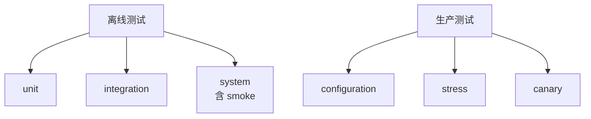

## Q
**Testing for reliability · 面向生产的测试**｜原则 · 加分

你们的单元测试覆盖率很高，但线上仍然会因为配置错误、容量上限和新版本的低概率 bug 出事故。除了单元测试，还需要什么测试？

## A
**原则：** 测试是在**降低可靠性的不确定性**：每个在变更前后都通过的测试，都减少分析中要留的余量。只有失败的测试能证明"不可靠"，通过的测试并不证明"可靠"。离线测试要补上**在生产环境里**做的测试。

**怎么做（Google SRE book）：**
1. **三层离线测试：** unit（小单元）、integration（组装的组件，用依赖注入和 mock 隔离）、system（完整未部署的系统，含 smoke、performance、regression）。performance 测试能抓到慢慢变慢或内存增长（例如 8 GB 增长到 32 GB）；regression 是过去 bug 的目录。
2. **生产测试：** configuration test（对比生产实际配置和版本库中的）、stress test（找系统极限）、canary test（升级一部分服务器，让它们在真实流量里"烤"一会儿，更像结构化的用户验收）。
3. **从小处开始：** 先覆盖关键业务代码（如计费）和别人依赖的 API；每次发布都做 smoke test；每个 bug 先写成会失败的测试，逐渐形成回归集。
4. **基础设施：** 版本控制、持续构建、构建坏了是第一优先级。
5. **为什么有关系：** 发布前被系统测试挡住的 bug，修复时间为零（推送被阻止），平均无故障时间因此变长，团队可以更快发布功能。
6. **规模化：** 每个依赖都要测；高风险工具要加"健康检查屏障"；随机测试（如混沌类）要记录随机种子以便重放；配置要和代码一样按风险测试；用已知的好坏请求在生产里回放。

**常见错法：**
- **只有 unit：** 配置、容量问题发现不了。
- **没有明确目标：** "多写点测试"，没有覆盖目标和期限。
- **canary 当真测试：** 它是缓冲，不应是第一次发现 bug 的地方。

**回到题目：** 增加 smoke test 和 regression 集合；对生产配置做 configuration test；上线前做 stress test 找容量上限；发布用 canary，并在生产里回放已知请求。

面试官看什么 · 配哪类故事 · 出处

**面试官在考什么：** 你对"测试如何保证可靠性"有更完整的画面，而不是只会单元测试。

**适合配哪类故事：** 你补上了生产层面的测试（配置检查、压测、canary），抓到了单元测试覆盖不到的问题的经历。

**出处：** Beyer 等《Site Reliability Engineering》"Testing for Reliability"（sre.google/sre-book/testing-reliability/，2026-11-21 读取：Types of Software Testing、Creating a Test and Build Environment、Testing at Scale）

