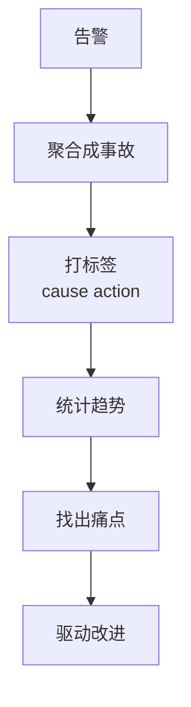

## Q
**Tracking outages · 把事故变成数据**｜原则 · 加分

经理问你："我们今年事故多不多？主要来自哪里？"你只能凭印象回答。怎么才能让事故数据说话？

## A
**原则：** 事故如果不被**记录和归类**，就只是故事，驱动不了改进。要把告警聚合成"事故"、打标签、做统计，才能建立基线、衡量进展、发现系统性问题和 toil。

**怎么做（Google 的 Escalator 与 Outalator）：**
1. **追踪确认与升级：** 一个集中的系统记录告警有没有被人确认，没有就升级到下一位（例如从主到副 on-call）。
2. **在事故层面，而不是单条告警：** 把相关告警聚合成一个 incident，因为一次网络故障会让很多团队收到重复告警；这样能分别统计"每天事故数"和"每天告警数"。
3. **打标签：** 自由格式，冒号形成层级，如 `cause:network:switch`；误报标 `bogus`；有些标签是链接，如 bug 编号。标签最能体现一个服务的痛点。
4. **做统计：** 每周/月/季事故数、每个事故有多少告警；跨团队、服务、时间比较。
5. **小心解读：** "导致事故最多"可能只是监控过敏或客户端表现不好；事故数量不反映修复难度或严重程度。
6. **交接：** 把选定事故的主题、标签和重要备注发给下一位 on-call。
7. **意外好处：** 看到别的团队同时有故障，加快诊断，也减轻对其他团队的打扰。
8. **在没有这套工具的团队：** 至少用表格记录每次事故的时间、影响、原因类别、告警是否先发出。

**常见错法：**
- **只统计告警数：** 一次事故被重复计数。
- **标签混乱：** 无法统计。
- **只看数量：** 忽略严重程度。

**回到题目：** 给上季度所有事故补上分类标签和影响，统计各类原因占比；用这份数据向经理要可靠性投入，也供 error budget 使用。

面试官看什么 · 配哪类故事 · 出处

**面试官在考什么：** 你是否用数据驱动可靠性工作，而不是凭印象。

**适合配哪类故事：** 你建立了事故统计，并用它揭示了一个隐藏的主要痛点、推动了专项改进的经历。

**出处：** Beyer 等《Site Reliability Engineering》"Tracking Outages"（sre.google/sre-book/tracking-outages/，2026-11-21 读取：Escalator、Outalator、Aggregation、Tagging、Analysis、Unexpected Benefits）；Orosz《The Software Engineer's Guidebook》ch17 §5（"Track incidents and measure their impact"）

