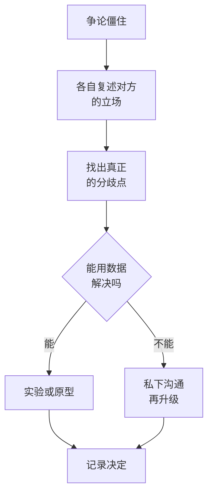

## Q
**Alignment & disagreement · 先问清分歧点**｜原则 · 必会

你和另一位资深工程师就"新服务用同步调用还是消息队列"争了两周，每次会议都不欢而散。你们各自的上级都开始过问了。你怎么推进？

## A
**原则：** 长时间争论多半是**还没弄清真正的分歧点**：可能是目标不同、对风险的估计不同、或者只是信息不同。先把分歧点说清楚，再用数据和实验去解决，最后才升级。

**怎么做：**
1. **复述：** 各自先说出对方的立场和理由，直到对方点头说"对，就是这样"。
2. **找分歧点：** 是目标不同（延迟 vs 可靠性）、事实不同（吞吐量到底多少）、还是价值判断不同（运维成本能否接受）。
3. **能用数据解决的就用数据：** 做小的原型或压测，让证据说话。
4. **先私下沟通：** 不要把分歧摆到不相关的人面前，尤其不要在资历浅的工程师面前争。
5. **最后才升级：** 先工程师对工程师，再请经理帮忙排优先级；升级时讲清楚两种方案和取舍，不是告状。
6. 决定后写下来（RFC 或 ADR）。

**常见错法：**
- **重复论点：** 声音更大不等于更有道理。
- **以资历压人：** 靠"我是 staff"让对方沉默，对方并没有被说服。
- **直接找经理仲裁：** 没试过自己解决，也失去了信任。
- **把分歧当成个人问题：** 目标是选出对产品最好的方案，不是赢。

**回到题目：** 约一次小会，每人先复述对方的立场。你们可能发现分歧是"能接受多大的延迟抖动"，那就拿真实的流量数据做压测；若数据不能决定，就带着两个方案的取舍文档去找共同的上级拍板，然后两人都执行。

**面试官在考什么：** 你处理技术分歧的方式：诊断、数据、升级的时机和方式。

**适合配哪类故事：** 你和同事意见相左，通过找出真正的分歧点或做实验解决，或在必要时有序升级的经历。

**出处：** Orosz《The Software Engineer's Guidebook》ch22 §1 "Internal Politics"（Problematic perceptions：inflexible、pull rank；Giving feedback）；ch22 §2；ch18 §5 "Problematic Stakeholders"；ch16 §6 "Engineering dependencies"（先工程师之间沟通，再升级）
