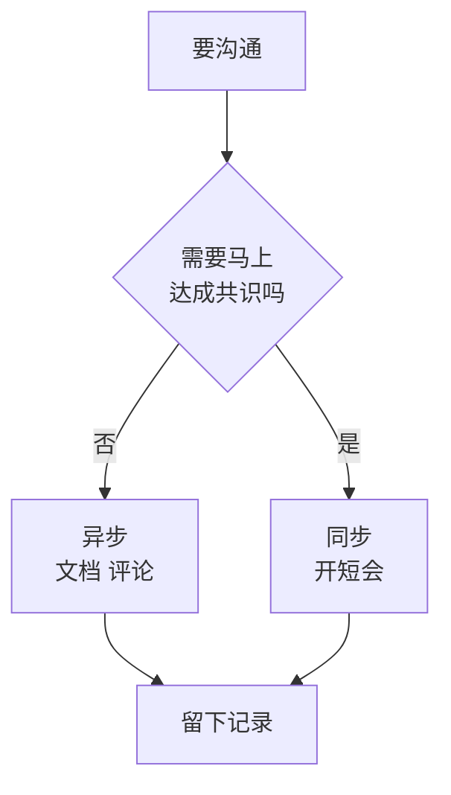

## Q
**Async & remote · 默认写作，约定时区**｜原则 · 加分

团队分布在三个时区，每次讨论都要等到有人醒着，决定要三四天才出；你们也开始觉得不开会又"各说各的"。怎么设计协作方式？

## A
**原则：** **async（异步）**是不要求对方同时在线就能推进事情的沟通方式。默认用写作（文档、issue、聊天）做异步，它能跨时区、留下记录；但**需要新鲜共识的决定**要用同步，不是二选一。

**怎么做（GitLab handbook）：**
1. **异步是起点：** 用公开的 issue、MR、聊天频道，让信息透明、持久；写下来的东西可以被不同时区和之后加入的人读到。
2. **同步用于：** 对齐战略转向、解决真正的分歧、与新高管建立信任、上下文难以写清的排障。一个来回要四天十七条回复才收敛的线程，不如三十分钟同步。
3. **纯异步的失败模式：** 决定上"最终一致"：线程分叉、上下文漂移、没人知道谁定了什么。
4. **时区约定：** 开会要查参与者时区，轮流在合适的时间主持；邀请提前；录制并在会后尽快附上记录，方便异步消费。
5. **异步不等于放任：** 新人会觉得孤独，要有刻意的同步时间、指导和上下文传递。
6. **同步不代替准备：** 没读议程和预读材料，就只是没准备好。
7. **默认写作的好处：** 写作迫使思路清楚；决定和理由都留在文档里，可对应到 ADR 和 design doc。

**常见错法：**
- **全异步：** 决定迟迟不出、人孤立。
- **全同步：** 总有人在凌晨开会。
- **写了没人读：** 没有约定回复期限和责任人。

**回到题目：** 约定：日常信息和提案写在文档里，评论期 48 小时；有分歧时约一次重叠时段的短会，会后把结论写回文档；新人第一个月每周与导师和队友同步。（评论期长度是示例，由团队自定。）

面试官看什么 · 配哪类故事 · 出处

**面试官在考什么：** 你是否理解远程协作的取舍，能设计适合团队的规则。

**适合配哪类故事：** 你为分布式团队建立了异步写作和少量同步会议结合的做法，让决策更快、更透明的经历。

**出处：** GitLab Handbook《Communication》"Asynchronous communication" 与《Sync vs. Async Culture》（handbook.gitlab.com/handbook/communication/sync-vs-async-culture/，2026-11-21 读取）；《All-Remote Meetings》（时区、录制）；leaf 引用的 /all-remote/asynchronous/ 页已 404，改用上述官方页

