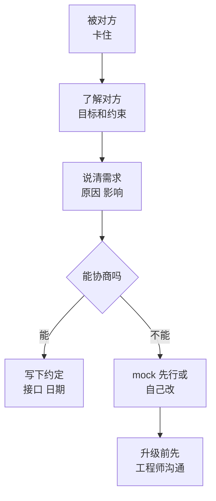

## Q
**Cross-team work · 别绕过，写下来**｜原则 · 必会

你的项目要等另一个团队改他们的一个服务，他们的排期要等到下个季度。你们的截止日期在六周后。你可以自己去改他们的代码并发 PR，也可以绕开他们另做一个。你该怎么办？

## A
**原则：** 对方有自己的目标和约束。先了解它，把你的需求、接口、日期**写下来并约定**；**别绕过**对方，绕过去的代价往往在以后出现。

**怎么做：**
1. **画一张团队地图：** 你依赖谁、谁依赖你、谁做类似的功能、谁用同一套基础设施。给每个团队至少认识一个人。
2. **谈需求：** 讲清你需要什么、为什么、如果他们不做会有什么影响。
3. **了解他们的约束：** 平台团队的改动不能影响所有下游，要承受更多限制。
4. **缓解办法：** 如果有 internal open source 机制，主动提出自己做并发 PR（要预留理解他们代码的时间）；用 mock 先解开自己的工作；把依赖从关键路径上拿掉（自己做个简单版本，要承担维护）；全组一起上；最后才请经理排优先级。
5. **写下约定：** 接口、日期、检查点，让双方都有据可依。

**常见错法：**
- **绕过对方：** 自己做一个替代，结果两套系统并存，没人维护。
- **低估代价：** 自己改别人的服务，需要大量背景知识。
- **口头约定：** 没有记录，日期没人记得。
- **一上来就找上级：** 工程师之间还没谈过，对方觉得被告状。

**回到题目：** 先找对方的工程师谈：你的日期、你需要的接口、对方为什么排到下季度。如果可以，提出自己提 PR 来实现，由他们评审；同时让你的代码对着 mock 先开发，约定每两周一个检查点。写进文档并发给双方的经理知情。

**面试官在考什么：** 跨团队协作的成熟度：尊重对方的约束，同时让自己的项目不被卡死。

**适合配哪类故事：** 你被另一个团队的依赖卡住，通过协商、mock 或共同开发解决，并留下清楚约定的经历。

**出处：** Orosz《The Software Engineer's Guidebook》ch12 §5 "Working with Other Engineering Teams"（Draw a map of teams；Introduce yourself）；ch16 §6 "Engineering dependencies"（mitigations）
