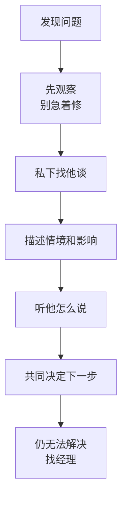

## Q
**Difficult conversations · 难谈的话先私下谈**｜原则 · 加分

组会上同事 A 反复打断新人 B，大家都很尴尬。你知道应该说点什么，但不想当着所有人让 A 难堪。你怎么处理这次对话？

## A
**原则：** 难的对话要**私下、当面、先弄清对方视角、聚焦行为与影响**。目标是让对方变得更好、关系不变差，而不是赢。

**怎么做：**
1. **先观察：** 不要立刻去"修"团队，先弄清情况；私下和相关人聊，人在私下更坦率。
2. **群体场合里降温：** 争论变热时，先把情绪降下来，把焦点拉回要解决的问题。你有资历，旁观不友善行为等于默许。
3. **私下谈，当面谈：** 邮件和聊天更容易误解；在场能看到对方反应。
4. **描述情境和影响，再问：** "会上你打断了 B 几次，他之后很少发言。你怎么看？"
5. **说明立场：** 你想让他更好，沉默更容易；这只是你的观察。
6. **对"政治化"的行为也一样：** 对同级直接反馈或找经理，对下级直接说清具体行为并听他的版本，对上级通过经理。
7. **不是你的问题就升级：** 你的经理对团队动态最终负责；带着建议，而不是只抛问题，也不要让经理意外。
8. **难缠的跨团队局面，用口头而不是书面沟通。**

**常见错法：**
- **当众纠正：** 对方只剩防御。
- **憋到爆发：** 事情已经大了才说。
- **只说"你态度有问题"：** 没有具体行为。

**回到题目：** 会后单独约 A："今天会上我注意到 B 几次被打断，之后就没再开口。我想听听你的看法，也想一起想想怎么让新人更敢说。"如果下次仍发生，把观察告诉经理。

面试官看什么 · 配哪类故事 · 出处

**面试官在考什么：** 你有没有勇气开口，又有分寸。

**适合配哪类故事：** 你私下处理了一次团队摩擦或行为问题，既解决了问题又保住关系的经历。

**出处：** Orosz《The Software Engineer's Guidebook》ch12 §4 "Giving Feedback"（in-person、on their side、end positively）；ch20 §4 "Improving Team Dynamics"（First, observe；Talk privately；Reduce negative interactions in group settings；escalate to your manager）、§5；ch22 §1（Giving feedback on "bad" politics）

