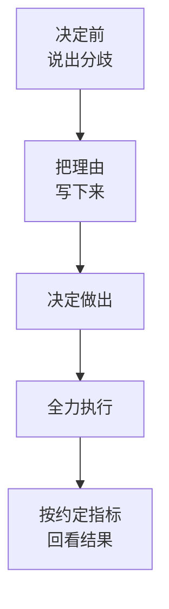

## Q
**Disagree and commit · 表达、记录、执行**｜原则 · 必会

团队讨论后决定用方案 B，你强烈认为方案 A 更好，你的意见被听取但没有被采纳。会后你应该怎么做？

## A
**原则：** 在决定**之前**充分表达不同意见；决定**之后**全力执行，不消极抵抗。这样团队既有真实的讨论，又能快速前进。

**怎么做：**
1. **表达：** 在决定前把你的意见和理由讲清楚，有数据的拿数据，主动参与讨论。
2. **记录：** 把你的担忧和决定写进文档（RFC 或 ADR），写明在什么情况下要重新考虑。
3. **执行：** 决定做出后，像它是你自己的方案一样推进；不在背后抱怨，不拖延。
4. **回看：** 约好指标和时间点，如果你的担忧成真，那时有据可依。

**常见错法：**
- **消极抵抗：** 表面答应，实际拖延或做得很勉强。
- **事后翻旧账：** "我早说过了"，会破坏信任。
- **被武器化：** 当有人在没有真正分歧的前提下强行要求别人"commit"，这样的决定短期高效，但很少赢得人心。
- **事前不说：** 决定时沉默，事后才抱怨。

**回到题目：** 会上说完意见就不再重复；写一段话放进 ADR："我倾向 A，原因是……；若出现 X 指标，建议重新评估"。然后在实现 B 时认真做好，发现风险及时同步。

**面试官在考什么：** 你的成熟度：能坚持观点，也能接受团队决定并负责执行。

**适合配哪类故事：** 你的意见没被采纳，但仍全力执行，并在后来用记录或数据推动了必要调整的经历。

**出处：** Orosz《The Software Engineer's Guidebook》ch22 §1 "Internal Politics"（"Bulldozing their will through"：Amazon 的 "have a backbone; disagree and commit"，以及它被武器化的风险）
