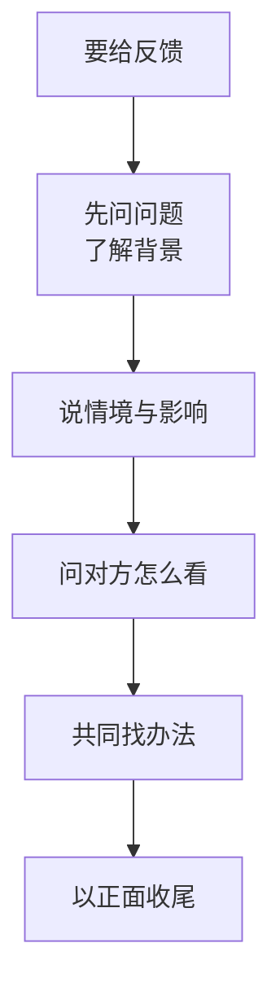

## Q
**Feedback · 给与收**｜原则 · 加分

你看到同事的 PR 把一个本可避免的 bug 带到了线上。你想给反馈，又怕让对方觉得被指责。同时你自己最近收到一条"你的代码质量要提高"的反馈，很模糊。分别怎么处理？

## A
**原则：** 好反馈**具体、说情境与影响、让对方参与找方案**；收到反馈要**把模糊的话变具体**。反馈比沉默难，但沉默是浪费成长的机会。

**给反馈（做法）：**
1. **正面反馈要具体且真诚：** 不说"做得好"，说"你把四个边界情况都处理并写了测试，这种细致我们需要更多"。只在真心时说。
2. **负面反馈先提问：** 例如问"你考虑过怎么测这个改动吗？"对方可能有背景，也可能是疏忽，没有负面情绪。
3. **说情境和影响：** 描述看到了生产 bug 及其影响，再问对方怎么看、怎样减少再发。
4. **避免"你应该"：** 除非你是经理；帮对方自己想出办法，可以说你会怎么做。
5. **当面谈：** 邮件或聊天更容易被误解。
6. **表明站在对方一边：** 指出沉默更容易，你说是希望他变得更好；声明你不是他的经理，只是观察，他可以不同意。
7. **以积极收尾。**

**收反馈（"解码"糟糕的反馈）：**
- 要求**具体例子**（"能看一下具体哪个 PR 吗？"）；
- 问**影响**；
- 要**建议**（"你会怎么做？"）；
- 不同意就**解释理由**，对方可能缺少背景。
- 主动请求时，问具体的事，而不是"对我有什么看法"。

**常见错法：**
- **在群里公开指出。**
- **一堆形容词：** "不够严谨"、"不专业"没有可改的行为。
- **听到反馈就辩解。**

**回到题目：** 约同事当面谈："上周那个 bug 影响了 X。我想听你怎么看，下次能怎么提早发现？我不是你的经理，只是希望一起把这个环节做好。"自己收到的模糊反馈，回问"能给我一个具体的 PR 吗？"

**面试官在考什么：** 你的反馈是否让人变好、关系不变坏；你接受反馈时是否成熟。

**适合配哪类故事：** 你给了一次让对方真正改变的反馈，或把一条模糊的反馈变成了可行动的改进的经历。

**出处：** Orosz《The Software Engineer's Guidebook》ch12 §4 "Giving Feedback"（Better ways to give positive feedback；Giving constructive or negative feedback）；ch2 §4 "Ask and Give Feedback"（Ask for feedback；Give feedback to others；Decode poorly delivered feedback）
