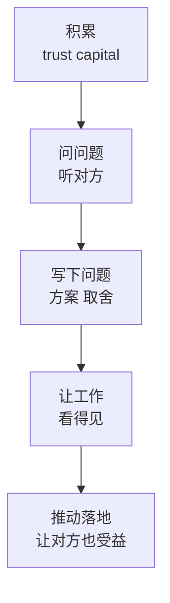

## Q
**Influence without authority · 没有职权怎么推动**｜原则 · 必会

你发现团队用的发布流程让所有服务每次都多等二十分钟，想推动改成新的流水线。但你不是任何人的上级，涉及的三个团队也都有自己的优先级。你怎么让这件事发生？

## A
**原则：** 没有职权时，靠的是**信任资本（trust capital）**：别人听你的，是因为信任你。先积累信用，再让提议对对方有利，并让对方也"赢"。

| 信任的来源 | 说明 |
|---|---|
| 职位 / 权威 | 有头衔的人被关注 |
| 资历 | 在组织里久、理解深 |
| 专长 | 某领域的专家被找去解决那类问题 |
| 履历（track record） | 资历浅也能靠"把事做成"建立影响力 |
| 工作可见度 | 做得好却没人知道，等于没做 |

**怎么做：**
1. **先听：** 多问问题、认真听，尤其是刚到一个新组织时。
2. **说清楚你的观点：** 提案先写问题，再写你偏好的方案，最后写已知的未知和取舍：先让人认同问题，再争取对方案的支持。
3. **在设计讨论中表态并解释理由**，不当沉默的旁观者。
4. **亲自动手把事做成：** 先把自己的活干好，再谈影响别人。
5. **让工作可见：** 记工作日志，给经理和相关方分享影响、难点、学到的东西。
6. **无私支持别人：** 在别人的提案上帮忙、公开给正面反馈；负面反馈尽量私下。
7. **写作：** 书面文字能触达组织里更多人，让决定可持续。

**常见错法：**
- **以职位压人：** "我是 staff，就该这么做"，会让人觉得你只想推自己的主张。
- **前后说法不一：** 对不同的人讲不同的话，信任会迅速下降。
- **只做自己的事：** 从不帮别人，没人愿意帮你。
- **做完不说：** 以为工作会自己说话。

**回到题目：** 先找出每个团队最在意的痛点（也许是发布等待），测出真实浪费的时间，做一个小范围的试用，用数据证明；提案里写清问题、方案、风险；让试用团队自己讲收益。这样三个团队都觉得是在解决自己的问题。

**面试官在考什么：** 你有没有一套不靠头衔的推动方法，知道信任是积累出来的，也是可以被设计的。

**适合配哪类故事：** 你没有职权，却靠数据、试点和支持别人，说服多个团队采用某个改变的经历。

**出处：** Orosz《The Software Engineer's Guidebook》ch22 §2 "Influencing Others"（Earn trust capital、Explain your point of view、Make your work visible、Support others selflessly）；ch12 §6
