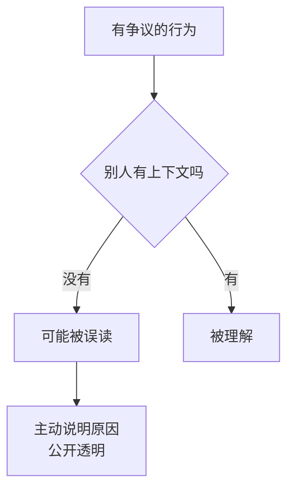

## Q
**Internal politics · 做有影响力的人，不做"政治化"的人**｜原则 · 加分

你被评审委员会邀请评议同组同事的晋升提案，但你因利益冲突不能投票；事后同事认为你"没支持他"，团队里传出你"有自己的算盘"。你怎么应对，之后怎么不被拖进去？

## A
**原则：** 办公室政治有坏名声，但**影响力是它"好"的形式**：能凝聚支持，让团队或组织受益，而不是主要为自己。要被看成有影响力，而不是"政治化"。**认知很重要**：别人缺少上下文，会按最糟的动机去猜。

**怎么做：**
1. **了解"坏"形象：** 只顾自己、挤开别人、僵化拉职级、两面三刀、强行"disagree and commit"、不信任别人、只说不写代码。
2. **说明上下文：** 例子：评审时回避是出于避免利益冲突，但容易被误读；能说明时就说明原因。
3. **说同样的话：** 对不同人讲不同的话，会让人觉得你在操纵，信任迅速下降。
4. **用理由而不是职级：** 避免"我是 staff，就这么定"。
5. **别脱离一线：** 不写代码、不值班、却推动影响工程师的改动，会被视为远离一线。
6. **也别拖进别人的政治：** 对"政治化"行为的反馈，同级直接说或找经理，对下级直接说，对上级通过经理。
7. **选择战场：** 保留信用给真正重要的事。

**常见错法：**
- **以为只靠技术就够：** 常见情形：成功还取决于软技能与网络。
- **对不同人说不同的话。**
- **为了避嫌沉默：** 而不说明。

**回到题目：** 向那位同事私下解释：因为你与他同组，规则要求你回避，这不代表你不支持；之后遇到类似情况，提前说明。

**面试官在考什么：** 你对组织动态的敏感度，以及能否保持诚信与影响力。

**适合配哪类故事：** 你在一个被误解的场景里，通过透明和一致的沟通，重新赢得了信任的经历。

**出处：** Orosz《The Software Engineer's Guidebook》ch22 §1 "Internal Politics"（The "wrong" type of politics；Problematic perceptions；Giving feedback on "bad" politics）
