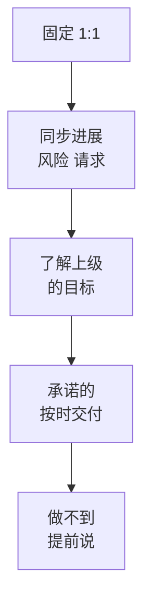

## Q
**Managing up · 让上级少意外**｜原则 · 必会

你的经理上个月在向上汇报时，被问到你负责的项目进度，他答不上来，很尴尬。事后他对你说："我希望不要再有这种情况。"你怎么改善和上级的工作方式？

## A
**原则：** 上级没有时间看你的每个 PR。**让他少意外**：有节奏地同步、对齐期望、带着方案去提问。

**怎么做：**
1. **固定 1:1：** 用来同步你做的事、工作日志里的成绩与难点，也问他最近的挑战。
2. **主动告诉，不要假设他知道：** 他不会看你的每个 PR，也不知道你花半天帮同事调试。
3. **了解他的目标：** 问他下个月、半年最大的挑战；他最担心可靠性，你就从可靠性帮起。
4. **交付承诺，做不到提前说：** 约定日期的事按时完成并告知；若要晚，事先说。不确定能不能完成的事，别轻易承诺。
5. **带着方案提问：** 提出问题时附上选项和你的建议。
6. **建立信任：** 对他坦诚透明，包括坏消息。
7. **成为盟友：** 主动分担一部分工作，如协调工程方案、带项目、疏通依赖。

**常见错法：**
- **只在被问时才汇报：** 经理被动、容易被打个措手不及。
- **只报喜：** 风险暴露太晚，他来不及帮忙。
- **提问题不给方案：** 把决策负担全推给上级。
- **不知道上级的目标：** 做的事和他最在意的事对不上。

**回到题目：** 先道歉没早同步。约定每周固定 1:1，提前准备一页：已完成、风险与缓解、需要他决定的事；另外每周发一封短的项目进度邮件，并抄送给相关方。这样他向上汇报时手里有现成材料。

面试官看什么 · 配哪类故事 · 出处

**面试官在考什么：** 你是否会管理和上级的信息流，并主动建立可预测性。

**适合配哪类故事：** 你改进了与上级的沟通节奏，让对方更放心、你得到更多支持或自主权的经历。

**出处：** Orosz《The Software Engineer's Guidebook》ch2 §5 "Make Your Manager an Ally"（Tell them, don't assume；Understand your manager's goals；Deliver what you agree on）；ch22 §3 "Collaborating with Managers"

