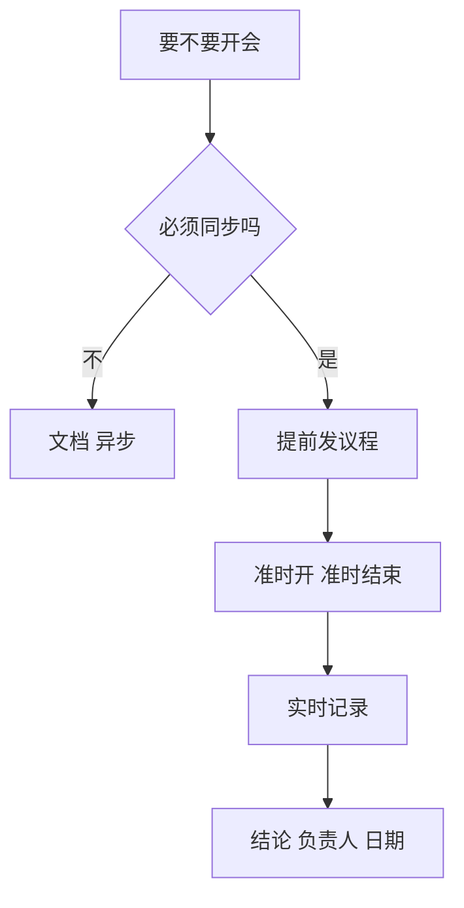

## Q
**Meeting hygiene · 开会的规矩**｜原则 · 加分

你的团队每周有六七个会，常常没有议程，开到一半有人才发现不需要自己在场，会后也没人记得决定了什么、谁去做。你怎么整顿？

## A
**原则：** 会议是同步沟通的昂贵工具，只用于必须同步的事：**有目的、有议程、有结论、有负责人**。其余能异步的就异步。

**怎么做（GitLab handbook）：**
1. **先问是否必要：** 能异步推进并达到目的就异步。需要同步的典型场景：真正的分歧、对齐战略转向、建立信任、上下文还难以写下来的排障。
2. **"No agenda, no attenda"：** 每个会议在邀请上附一份实时文档作为议程，包含标题、与会者、背景（参与者需要提前读什么、为什么聚在一起、期望的结果）、日期、可异步添加的问题。议程只有一份，发现有多份就停下来澄清。
3. **提前发：** 邀请与议程提前 72 小时，至少 24 小时发出，让人决定自己是否需要到场。
4. **准时开、准时结束：** 日历里设"speedy meetings"，会议为 25 或 50 分钟，留出写笔记的时间。
5. **实时记录：** 结论、行动项、负责人写进同一份文档。
6. **录制并链接：** 让不同时区的人异步获取。
7. **定期会议要敢取消：** 目的达成就取消或缩短，取消不是冒犯。
8. **不是所有会议都需要议程：** 随意的 coffee chat 不用。

**常见错法：**
- **会议就是例行：** 没人问是否还需要。
- **有讨论没结论：** 没有负责人，下次还要再开。
- **议程多份：** 没有单一事实来源。

**回到题目：** 先盘点每个会的目的，砍掉或改成异步更新；其余的加议程和实时笔记；每个会结束前读一遍"决定了什么、谁、何时"。

**面试官在考什么：** 你对团队时间的尊重，以及推动流程改进的能力。

**适合配哪类故事：** 你精简或重构了团队会议，让时间花得更值、决定更清楚的经历。

**出处：** GitLab Handbook《All-Remote Meetings》（handbook.gitlab.com/handbook/company/culture/all-remote/meetings/，2026-11-21 读取："No agenda, no attenda"、72 小时/至少 24 小时、speedy meetings、Document everything live）；《Sync vs. Async Culture》（handbook.gitlab.com/handbook/communication/sync-vs-async-culture/）
