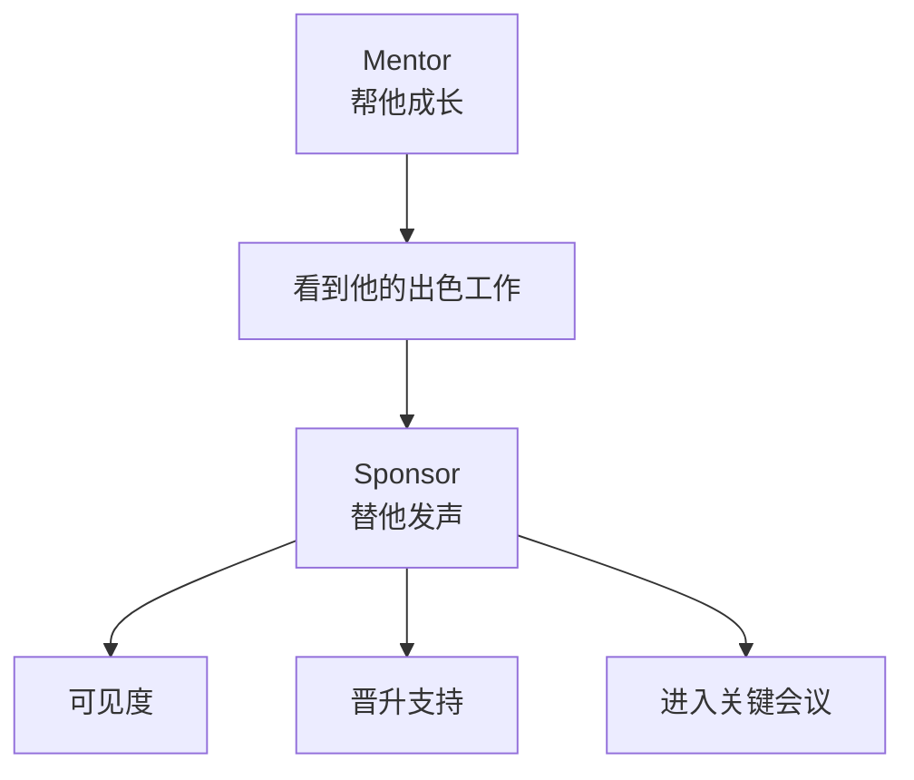

## Q
**Sponsorship vs mentorship · 谁在会议室里替你说话**｜原则 · 加分

你带的一位中级工程师做了很出色的项目，但经理似乎没注意到，下个季度的晋升讨论里也没人提他的名字。你作为资深工程师，除了继续给建议，还能做什么？

## A
**原则：** **mentoring（指导）**是引导对方、分享知识、帮他成长；**sponsoring（担保/举荐）**更进一步：**利用你的位置，替对方在他不在场的地方发声**。两者常重叠，但 sponsor 靠的是你的影响力。

| | mentoring | sponsoring |
|---|---|---|
| 做什么 | 指导、倾听、分享经验 | 倡导、推荐、争取机会 |
| 发生在哪 | 你们两人之间 | 对方不在的会议里 |
| 靠什么 | 你的经验 | 你的影响力和信誉 |

**怎么做（五种）：**
1. **让好工作被看见：** 邀请他在小组会上讲自己的项目。
2. **为晋升背书：** 你判断他已在做下一级的事，就和他的经理及其他经理谈。
3. **带他进"房间"：** 复杂项目的规划阶段，你本可以自己做，但把他拉进来，让他对关键决定有发言权。
4. **替他争取项目：** 经理讨论谁带哪个项目时，推荐他；经理犹豫，就提出自己也部分参与。
5. **在封闭会议里发声：** 例如绩效校准会，确保他的成果不被忽略。

**常见错法：**
- **只做 mentor，从不替人开口：** 对方的成果在他不在的地方没人提。
- **推荐没做到的事：** 你的信誉受损，之后你的话就没分量了（sponsor 靠的是你的影响力）。
- **只 sponsor 同一个人：** 忽略其他更需要机会的人。

**回到题目：** 先和经理说明他的具体成果和影响；邀请他在组会上展示；在下一次晋升或项目分配讨论里明确推荐，并给出证据。

**面试官在考什么：** 你是否把影响力用于帮助别人，而不仅是自己。

**适合配哪类故事：** 你利用自己的位置让一位同事的工作被看见、获得晋升或关键项目的经历。

**出处：** Orosz《The Software Engineer's Guidebook》ch22 §6 "Helping Others"（"Mentor others"、"Sponsor others" 的五种做法）；ch12 §3 "Mentoring"
