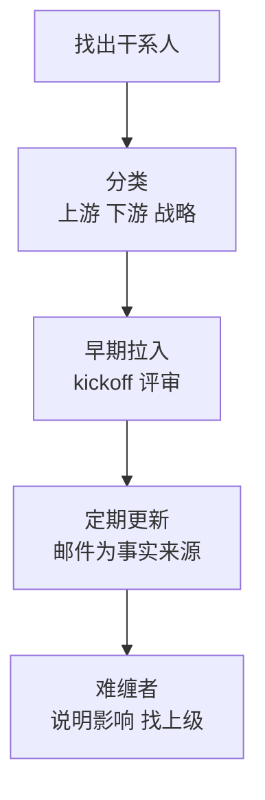

## Q
**Stakeholder management · 让相关人都知情**｜原则 · 加分

你们做了一个月的功能，在上线前被法务叫停，理由是他们从未被告知。另一边，有个业务负责人天天问"什么时候好"。你怎么管理干系人？

## A
**原则：** 干系人管理就是**确保所有需要知道你们在做什么的人，都知道**。不知道谁是干系人会造成浪费和延误；已知的干系人要保持知情，不被决定吓到。

**怎么做：**
1. **找出谁：** 直接问已知干系人还有谁；看架构改动会碰哪些代码和服务，联系它们的所有者；想到"常见嫌疑"（工程、产品、设计、数据科学、法务、客服等）。
2. **分上游、下游、战略干系人：** 上游是你依赖的人；下游依赖你；战略干系人关心项目的业务意义。
3. **早期拉入：** 例：忘了把 RFC 发给要被改动服务的团队，晚了两周；有团队做了一个月，被法务叫停。
4. **保持知情的三种方式：** 会议、异步更新、混合；干系人有重要输入时开会，否则异步。
5. **定期更新邮件：** 包含进度、风险与缓解、时间线变化、对期限的信心；让它成为"事实来源"。
6. **难缠的干系人：** 上游不可靠的，说明你需要什么和不处理的影响；下游总催的，用更新和里程碑给出信心；战略型的，持续给更新、对挑战保持透明。

**常见错法：**
- **只通知熟人：** 法务这类"不显眼"的干系人被漏掉。
- **只在出问题时联系：** 对方平时没有上下文。
- **每人一对一沟通：** 不可扩展，用群体更新。

**回到题目：** 回顾后补做干系人清单（法务、安全、客服、下游团队）；在下一个项目 kickoff 就邀请他们；每周发一封更新邮件，业务负责人看邮件，不必天天问。

面试官看什么 · 配哪类故事 · 出处

**面试官在考什么：** 你是否系统地管理期望，避免项目被意外打断。

**适合配哪类故事：** 你用早期识别干系人和定期更新，避免了一次项目被外部阻断或重工的经历。

**出处：** Orosz《The Software Engineer's Guidebook》ch18 §3 "Figure Out Who Your Stakeholders Are"、§4 "Keep Them in the Loop"、§5 "Problematic Stakeholders"

