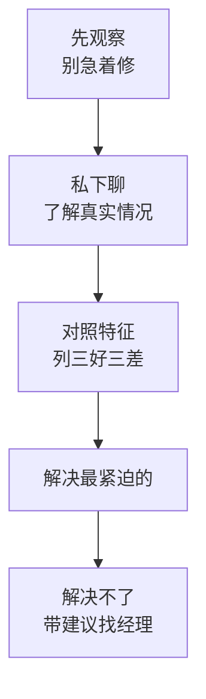

## Q
**Team health & dynamics · 诊断一个团队**｜原则 · 加分

你刚加入一个新团队，经理说"感觉哪里不对，但说不清，你帮着看看"。大家都在忙，产出不高。你怎么诊断，又从哪里下手？

## A
**原则：** 先**观察和倾听**，对照健康与不健康的特征，再**解决最紧迫的一个问题**，解决不了就带着建议找经理。团队动态最终由经理负责，不是每个问题都归你。

**健康团队的五个特征：** clarity（目标与原因清楚）、execution（能交付且可见）、good morale、healthy communication、engaged team（人人参与）。

**怎么做：**
1. **测 clarity：** 问几位工程师团队的目标和原因，答案大致一致就清楚。
2. **对照不健康的信号：** 常见的有：糟糕的管理、"brilliant jerk"、技能不足、缺反馈、方向不清、"原地踏水"、过多上下文切换、流程过多或没有、技术债拖累；结构性原因如大量离职、新人太多、初级太多、突然转向。
3. **成长期的痛点：** 无声的冲突和小道消息、悄悄恶化的执行问题、好工作没人看见、离职风险上升、资深过多却缺少挑战。
4. **观察后列清单：** 写下团队最好的三件事和最该改进的三件事；或开团队反思会。
5. **私下聊：** 一对一问"什么顺利、最大的问题是什么"，人在私下更坦率；信任是前提。
6. **改进动态：** 在群体场合减少负面互动；让初级成员参与讨论（Team B 优于 Team A）；先解决最紧迫的问题，用谈话、反馈或以身作则。
7. **升级：** 绩效问题是经理的，不是你的；带着方案，提早告知，别让经理意外。

**常见错法：**
- **一上来就"修"：** 还没看懂，反而制造冲突。
- **把所有问题自己扛。**
- **只看产出：** 忽略 clarity 与士气。

**回到题目：** 一周里一对一聊每位成员；问大家团队目标是什么；对照清单，发现 clarity 不一致与好工作没人看见两项最突出，就先组织一次目标同步，并把成果在更大范围展示；其余带着建议告诉经理。

**面试官在考什么：** 你对团队的整体视角：诊断，而不是抱怨或越权。

**适合配哪类故事：** 你诊断了一个团队的问题，从最关键的一点入手并让它改善的经历。

**出处：** Orosz《The Software Engineer's Guidebook》ch20 §1 "Healthy Teams"、§2 "Unhealthy Teams"、§3 "Teams with Growing Pains"、§4 "Improving Team Dynamics"；ch19（团队结构，背景）
