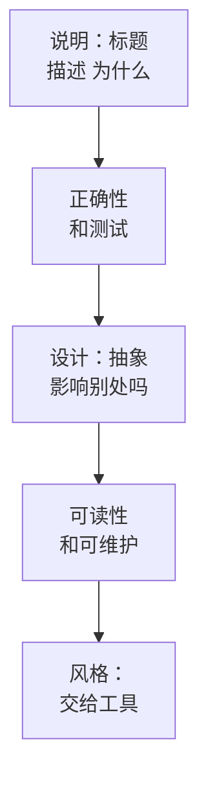

## Q
**Code review goals · 审什么**｜原则 · 必会

你收到一个 PR：两千行，标题叫"重构订单模块"，描述只有一句"见代码"，测试没改。你有半小时。你会看什么，怎么回应？

## A
**原则：** 好的 code review 看的是**这个改动本身，以及它如何融入整个代码库**，不只是找语法错误。从浅到深有几层：

| 层 | 要问的 |
|---|---|
| 说明 | 标题和描述清楚吗？"为什么要改"讲了吗？ |
| 正确性 | 逻辑对吗？边缘情况考虑了吗？测试覆盖了吗？功能行为有变化吗？ |
| 设计 | 这个改动有必要吗？引入的抽象和现有架构合不合？影响别的部分吗？ |
| 可读性、可维护 | 难懂的代码、含糊的命名、被注释掉的代码、重复、复杂逻辑能不能简化 |
| 风格 | 是否遵循规范；大部分应由 linter 自动处理 |

**怎么做：**
1. 一次改动只做一件事：太多内容混在一起，建议拆成多个聚焦的小 PR。
2. 看改动对更大系统的影响，不只看 diff。
3. 有重要的疑问未解决时，不要批准；小问题标成"nit"，不阻塞。
4. 批准要明确（LGTM），要求后续改动也要明确。
5. 紧急改动，评审人尽量让自己能快速响应。
6. 对所有人标准一致，不论职级和资历。

**常见错法：**
- **只盯格式：** 花时间在变量命名顺序，重要的设计问题没看。
- **橡皮图章：** 看不懂也批准。
- **来回争论几十条评论：** 很多评论说明有误会，当面聊更快。
- **大量 nit：** 说明缺少工具或规范；该自动化。

**回到题目：** 先回复："改动太大，描述也不够，能先拆成几个单一目的的 PR 吗？先说明为什么要重构。"如果要先看，就从描述缺失的"为什么"和"测试没改"这两个最大问题入手，其他留到拆分后。

**面试官在考什么：** 你对评审的目的的理解：保证正确和可维护，而不只是找错；以及在有限时间里抓大放小。

**适合配哪类故事：** 你通过一次评审发现了设计或影响范围的问题，避免了线上事故或大返工的经历。

**出处：** Orosz《The Software Engineer's Guidebook》ch12 §1 "Code Reviews"（A good code review…、Requesting changes before approving、Nitpick comments）
