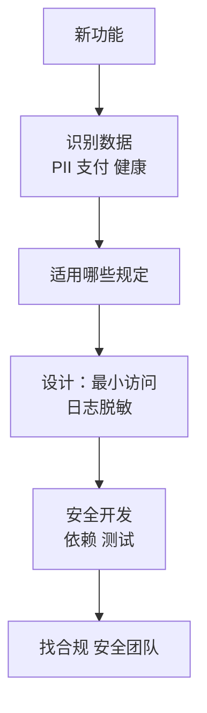

## Q
**Compliance, privacy & secure development · 默认要懂的**｜原则 · 加分

你在设计一个会处理用户信用卡和个人信息的新功能。法务说"要合规"，安全说"要安全"，你需要在设计里提前考虑什么？

## A
**原则：** 作为资深工程师，合规、隐私、安全开发是**默认要懂**的：违规的声誉和财务代价很高。你不必成为法务，但要知道有哪些规则、什么时候找专业团队。

**怎么做：**
1. **识别 PII：** 不应有人能访问，除非他应该；GDPR 扩展了 PII 的范围，只能为合法目的存储和处理。
2. **行业规定举例：** PCI DSS（信用卡）、HIPAA 或 ISO/IEC 27001（医疗）、FERPA（学生信息）、FCRA（征信相关）、Section 508（美国联邦机构的无障碍）、欧盟无障碍法案；还有各国隐私法。
3. **日志：** 记 PII 且无端到端加密会招来泄露；尽量不记，或匿名化；写日志指南，含 PII 一节；审计日志；用户 bug 报告和截图也不应含 PII，如信用卡号。定期复查记了什么。
4. **审计：** 通常由专门供应商做，要求常模糊；找做过的人，或请顾问；第一次最耗时，之后保持合规更容易。
5. **安全开发：** 熟悉自己领域的做法与常见威胁；OWASP 是语言无关的安全编码指南；依赖里的漏洞是持续威胁（提到 2021 年 Log4j 漏洞）；参加渗透测试，学到专家怎么攻击你的系统。
6. **与安全团队合作：** 在项目规划、关键代码变更时拉他们进来。

**常见错法：**
- **上线前才找法务和安全。**
- **把 PII 打进日志。**
- **依赖不更新。**

**回到题目：** 设计阶段列出会接触的数据类型并问合规团队适用的规定；信用卡信息走受支持的支付方案，不自己存；日志脱敏；规划时拉安全团队做威胁评审。

面试官看什么 · 配哪类故事 · 出处

**面试官在考什么：** 你的责任意识与风险敏感度。

**适合配哪类故事：** 你在设计阶段提前引入合规或安全评审，避免了后期返工或违规的经历。

**出处：** Orosz《The Software Engineer's Guidebook》ch23 §5 "Compliance and Privacy"（Regulations、Logging、Auditing）、§6 "Secure Development"；本卡不是法律建议，具体规定以合规团队为准

