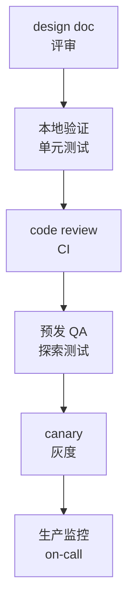

## Q
**Cost of quality · 越早越便宜**｜原则 · 必会

经理说："测试和评审拖慢了交付，能不能去掉一些，直接靠上线后监控兜底？"你怎么回答，哪些环节值得投入，哪些可以省？

## A
**原则：** 缺陷发现得越早越便宜，所以质量工作要**往前移（shift left）**。但每一层都有成本，要按风险选：把便宜、反馈快的层放前面，把昂贵的放在真正需要的地方。

| 层 | 好处 | 代价 |
|---|---|---|
| 设计文档评审 | 改动还便宜时发现设计错误 | 写文档的时间 |
| 自动化测试 | 验证正确、抓回归、当文档、当契约、重构安全网 | 写的时间、变慢、flaky、维护成本 |
| 独立测试环境 | 上线前验证 | 资源和数据维护成本高 |
| QA / 探索测试 | 发现真实用户使用才会出现的边缘情况 | 人力 |
| Canary、feature flag | 小范围先上，指标异常能回退 | 需要基础设施和清理旧 flag |

**怎么做：**
1. 先在改动成本低的地方多花力气：设计评审、本地验证、自动测试。
2. 风险高的地方叠加更多层（例如金融）；风险低、用户多的地方更依赖监控和自动化发布。
3. 对每个质量环节问："它拦住了什么？成本多少？"定期删掉没用的。
4. 对经理讲成取舍，不是"都要"：展示一次因为缺少某一层而付出的返工成本。
5. 上线后的监控和 on-call 是最后一道，不是替代品。

**常见错法：**
- **只靠生产兜底：** 每个缺陷都由用户先发现。
- **每一层都叠满：** 速度被拖垮，团队开始绕过流程。
- **不看数据：** 不知道哪层真正拦住了问题。

**回到题目：** 不同意整体去掉；提议分析最近的缺陷是在哪一层被发现的，把没拦住任何东西的重型步骤（比如手工回归）换成自动化或 canary，把省下的时间用在设计评审和关键路径的测试上。

面试官看什么 · 配哪类故事 · 出处

**面试官在考什么：** 你是否能在速度和质量之间做有依据的取舍，并知道不同层的成本和收益。

**适合配哪类故事：** 你调整了质量流程（加一层、删一层），既没有拖慢交付又减少了线上问题的经历。

**出处：** Orosz《The Software Engineer's Guidebook》ch14 §7 "Benefits and Drawbacks of Automated Testing"；ch17 §4 "Additional Verification Layers"（#1 environments、#3 QA、#4 exploratory testing、#5 canarying、#6 feature flags）；ch15 §1（design doc：发现问题越早越省）

