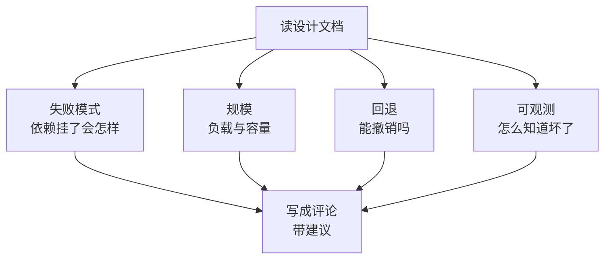

## Q
**Design review as reviewer · 评审别人的设计该问什么**｜原则 · 加分

同事发来一份设计文档请你评审，三页，看着很合理。你怎么在不大改的前提下发现真正的风险？

## A
**原则：** 评审设计不是挑文字，而是**帮作者在改动还便宜时发现风险**。用一份问题清单去问：失败时怎样、负载大了怎样、出事时怎么回退。

**怎么做：**
1. **先弄清目标：** 它要解决什么问题，非目标是什么，不确定就问。
2. **问失败模式（规划与模拟清单）：** 依赖挂了怎么降级？重试和退避？熔断？机房故障切换？灾难恢复？
3. **问负载和冗余：** 峰值负载是多少？容量怎么算？数据怎么复制？
4. **问回退：** 如果发布失败，怎么撤销？数据或 schema 变更时更难。是否单向门？
5. **问可观测：** 健康的定义（SLI）是什么？监控什么、告警什么？
6. **问发布：** 有 rollout 计划吗？阶段、健康判断、bake 时间、回滚；做过 pre-mortem 吗？
7. **问替代方案：** 为什么没选别的？
8. **提问式反馈：** 用问题而不是命令，给对方空间补充背景；区分必须改和建议。
9. **选评审方式：** 评论、会议或混合，以节省总时间为准。

**常见错法：**
- **只挑措辞与格式。**
- **提出一堆问题却不分轻重。**
- **等到实现完成才提意见：** 此时改动最贵。

**回到题目：** 在文档里留评论：依赖 X 不可用时是什么行为？峰值 QPS 的估算依据？上线失败如何回滚？哪个指标告诉我们它坏了？把最关键的两三个标成"需要回答"。

面试官看什么 · 配哪类故事 · 出处

**面试官在考什么：** 你的评审视角是否覆盖运维、规模和回退，而不是只看功能。

**适合配哪类故事：** 你在评审别人的设计时问出了一个关键失败场景，使方案在上线前被修正的经历。

**出处：** Orosz《The Software Engineer's Guidebook》ch15 §1（RFC 的目标与评审方式）；ch15 §4（rollout 计划、rollback、pre-mortem）；ch24 §7（Planning phase、Simulate failures）。提问清单是对这些章节的整理，该书没有单列的 "reviewer checklist"

