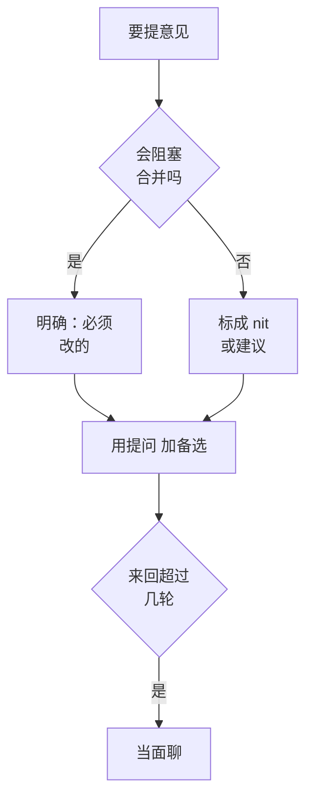

## Q
**Giving & receiving review · 说话方式**｜原则 · 必会

你给一位入职两周的同事的 PR 写了二十多条评论，口气比较直接，如"这写法不对，改掉"。他回复很少，之后再提的 PR 明显更谨慎、更慢。你该怎么调整？

## A
**原则：** 评审的**语气决定团队的士气**，也决定别人是否愿意接受反馈。提问多于断言，分清必须改和建议，改动要小，并让对话更像沟通而不是审判。

**怎么做：**
1. **提问，不断言：** 用开放式问题，"这里为什么选 X？Y 会不会更简单？"假设你可能漏了什么，先澄清再纠正。
2. **提供备选：** 给出可能更好的做法或绕过办法。
3. **区分必须与建议：** 阻塞的写清楚，非阻塞的标 nit；有未解决的重要问题就不批准，批准就明确。
4. **鼓励正面：** 好的解法也点出来，对新同事的前几次评审要特别用心，解释偏好的做法并给学习资料。
5. **小 PR：** 评审人更容易认真看，作者更快拿到反馈。
6. **当面聊：** 评论多、来回长，说明有误会；直接沟通省时间，也避免伤感情。
7. **自己是作者时：** 写清楚改动的"为什么"、测过哪些边缘情况；收到意见先当作问题，不先当作攻击。

**常见错法：**
- **强硬、带评判的语气：** 让对方防御，讨论变成争吵。
- **所有评论同等级：** 作者分不清哪些必须改。
- **一次堆很多 nit：** 该用 linter 和统一规范解决。
- **对不同的人用不同标准：** 对新人苛刻，对资深放水。

**回到题目：** 当面或视频聊几分钟，说明你的意图；回头把评论分成"必须改"和"建议"，改写成提问和备选；对他做得好的地方明确点出来。之后他的前几个 PR 你多花时间解释。

面试官看什么 · 配哪类故事 · 出处

**面试官在考什么：** 你是否理解评审是协作而不是裁决，会不会照顾对方感受并保持质量标准。

**适合配哪类故事：** 你改变了自己的评审方式，或在团队里推广更好的评审习惯，让评审更快、冲突更少的经历。

**出处：** Orosz《The Software Engineer's Guidebook》ch12 §1 "Code Reviews"（The tone of the review、Talking to each other、New joiners and code reviews）

