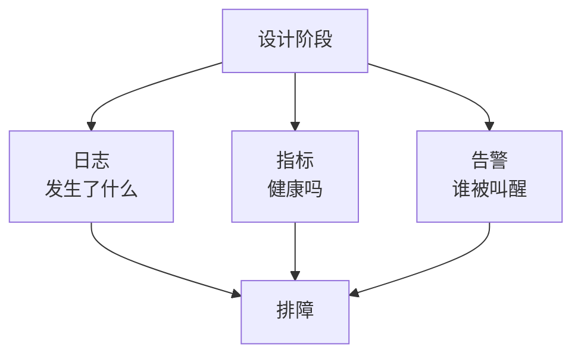

## Q
**Observability by design · 设计时就想好怎么看**｜原则 · 加分

你的新服务要上线了。线上出问题时，同事发现日志里没有请求 ID、关键业务流程没有指标，只能靠猜。你在设计阶段该留什么？

## A
**原则：** 日志、指标、告警要**在设计阶段**就规划，而不是出事后补。目的是回答："这个系统健康吗？出了问题我能在几分钟内知道、并找到原因吗？"

**怎么做（Orosz ch24）：**
1. **日志：** 目的是为生产问题捕获排障信息。要定：日志级别、结构（精确到毫秒的时间戳和时区）、哪些部分自动打日志、保留多久、生产只打 warning 以上。
2. **每个事件要有：** 时间与时区（何时）、系统或组件（何处）、用户（谁）、动作（什么）、状态（结果）、优先级、原因。
3. **记什么事件：** 认证与授权决定、数据访问和修改、系统变更（特别是权限）、无效输入、资源（内存、磁盘、CPU、带宽）、健康（启停、错误、延迟、备份成败）。
4. **让"对的"打法最容易：** 用轻量且有主张的日志框架，抽象供应商，团队有个简短日志指南，"约定好比没有好"。
5. **指标：** 看分位数，不只是平均：p50、p95、p99；监控正常运行时间、CPU 内存磁盘、响应时间、错误率；后端看 HTTP 状态码和延迟分位数。
6. **业务指标：** 讲"真正的故事"，基础设施指标好看时服务仍可能不健康。例如支付：添加支付方式成功数、错误数、流程耗时 p50。
7. **规划阶段：** 定义 SLI（什么算健康）、失败计划、负载、冗余，以及要监控和告警什么。
8. **别忘了 PII：** 不要记录个人敏感信息，或做匿名化。

**常见错法：**
- **事后补日志：** 出事时才发现缺字段。
- **只看平均值：** 掩盖最差情况。
- **只有基础设施指标：** 业务已经坏了，CPU 还很好看。

**回到题目：** 设计评审里加一节"可观测性"：关键流程的指标、日志字段、告警条件和 runbook；统一用团队的日志框架；上线前演练一次"这个告警响了我会看哪里"。

**面试官在考什么：** 你是否把运维视角带进设计，而不是只写功能。

**适合配哪类故事：** 你在设计阶段补上监控和日志，使后来的故障能被快速发现和定位的经历。

**出处：** Orosz《The Software Engineer's Guidebook》ch24 §2 "Logging"（Make your logging practices explicit、Events To Log、What To Log）、§3 "Monitoring"（percentiles、Monitoring business metrics）、§7 "Building Resilient Systems"（Planning phase）；ch23 §5（PII 与日志）
