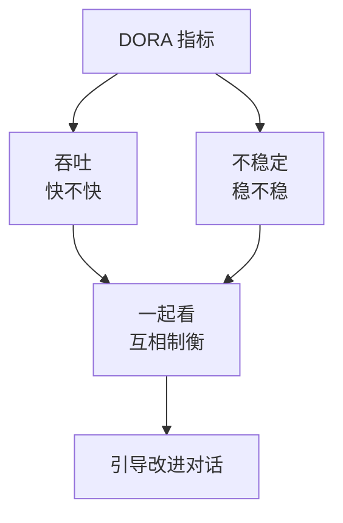

## Q
**Quality metrics · DORA 与它的局限**｜原则 · 加分

VP 说"我们要在所有团队推 DORA 指标，目标是每天部署多次"。你怎么看？怎么用这些指标，不被它误导？

## A
**原则：** DORA 指标衡量软件交付的**速度**和**稳定性**，是改进的**对话起点**，不是考核目标。把它们设成指标目标，就会被"博弈"（Goodhart 定律）；Orosz 本人也对只盯着它们持保留态度。

DORA 官网（2026-11-21 读取）的指标分两组：

| 组 | 指标 | 含义 |
|---|---|---|
| 吞吐 | change lead time | 从提交到上线的时间 |
| 吞吐 | deployment frequency | 一段时间内的部署次数 |
| 吞吐 | failed deployment recovery time | 从失败的部署中恢复要多久 |
| 不稳定 | change fail rate | 部署后需要立即介入（回滚、热修）的比例 |
| 不稳定 | deployment rework rate | 因线上事故而产生的计划外部署比例 |

（旧资料常说"四项"，当前官方页面列出的是五项。）

**怎么做：**
1. **多个指标一起看：** 速度和稳定性互相制衡，单看一个会被牺牲另一个。
2. **一个服务一个服务地看：** 它们适用于单个应用或服务，跨很不同的系统比较会误导。
3. **别当目标，别排名：** 设成目标会被博弈；用来引导改进，而不是给团队或组织排名。
4. **不要孤岛化：** 开发、运维、发布团队共享同一组指标，避免互相指责。
5. **先谈话，后上工具：** 官网建议先做快速自评或对话，再投入集成工具。
6. **配合其他信号：** 事故数量和影响、客户反馈、SLO，对质量更完整；Orosz 观察大型科技公司通常几小时内从提交到上线，按需每天多次部署。

**常见错法：**
- **把指标当 KPI 下发：** 团队把部署拆得很碎来刷次数。
- **拿不同系统互相比。**
- **只看速度。**

**回到题目：** "我同意追踪，但不作为目标：先让每个团队测出自己的基线；把五项放一起看；用它们讨论瓶颈，例如 lead time 长是因为评审还是发布流程。"

面试官看什么 · 配哪类故事 · 出处

**面试官在考什么：** 你是否理解度量的副作用，能把指标用于改进而不是考核。

**适合配哪类故事：** 你用一组交付指标找到流程瓶颈并改进，同时避免了指标被博弈的经历。

**出处：** DORA《DORA's software delivery performance metrics》（dora.dev/guides/dora-metrics/，2026-11-21 读取：五项指标与 caveats，数字可能随版本变化）；Orosz《The Software Engineer's Guidebook》ch17 §7 "Selecting an Approach"（DORA 段，作者保留意见）；ch21 §1（measurement 可被博弈）

