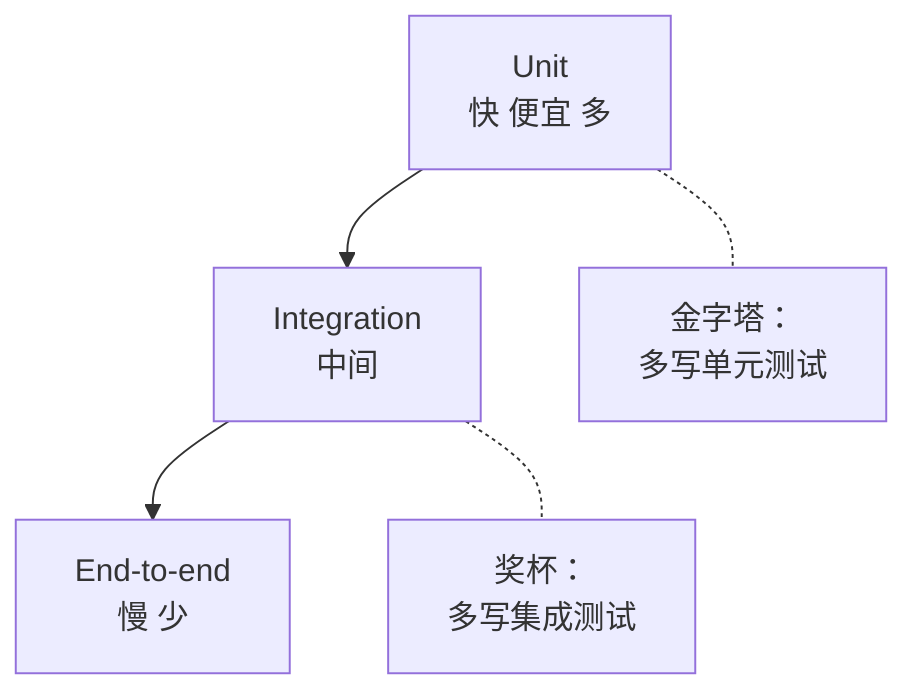

## Q
**Test strategy · 测什么、测多少**｜原则 · 必会

你们的订单后端有大量单元测试，但上线后常出现"两个服务对接不上"的问题；另一方面，端到端测试每次跑要一小时，经常因为网络抖动失败。你怎么调整测试策略？

## A
**原则：** 不要照搬某个模型，而是问：**对我们这个系统，什么样的自动化测试能在团队快速迭代的同时保证质量**？用测试金字塔和测试奖杯作为思考工具，不是教条。

| 类型 | 特点 |
|---|---|
| Unit | 隔离一个组件；应快、可靠（不 flaky）、聚焦 |
| Integration | 验证多个组件配合 |
| End-to-end / UI | 贴近真实使用，更慢、更容易 flaky |

| 模型 | 想法 |
|---|---|
| 金字塔（pyramid） | 大部分用单元测试，UI 测试尽量少；对几乎没有界面的后端系统很合适 |
| 奖杯（trophy） | "写测试，不要太多，主要写集成测试"；代码模块化后，很多 bug 出在组件之间 |

**怎么做：**
1. 先看你的 bug 出在哪里：对接问题多，就补集成测试。
2. 控制慢和 flaky：端到端测试少而精，只覆盖关键路径。
3. 单元测试保持快速、确定、聚焦；依赖注入让代码可单测。
4. 向和你阶段、行业相近的公司学习：有的公司更重监控和自动化发布，有的（如银行）更重手工测试。
5. 风险驱动：关键业务路径（支付、数据一致性）要测得更深。
6. 定期回顾：测试是否真的在拦住问题。

**常见错法：**
- **追求某个比例：** 为了像金字塔而写没用的测试。
- **只有单元测试：** 对接问题漏到线上。
- **端到端测试太多：** 慢、flaky，团队开始无视失败。
- **不测，因为"我写得很准"：** 重构时失去安全网。

**回到题目：** 加一层针对服务边界的集成测试，用真实依赖或契约测试覆盖订单的关键接口；把一小时的端到端精简成几条关键路径，并处理 flaky 的用例，不稳定的先隔离。

面试官看什么 · 配哪类故事 · 出处

**面试官在考什么：** 你的测试观是否以目标为导向，而不是照搬模型；能否用风险和成本做取舍。

**适合配哪类故事：** 你重新设计了测试结构（补集成测试、减 flaky），让上线问题明显变少、CI 更快的经历。

**出处：** Orosz《The Software Engineer's Guidebook》ch14 §4 "Mental Models for Automated Testing"（testing pyramid、testing trophy、"There is no single best approach"）；ch14 §1 "Unit Tests"（fast、reliable、focused）

