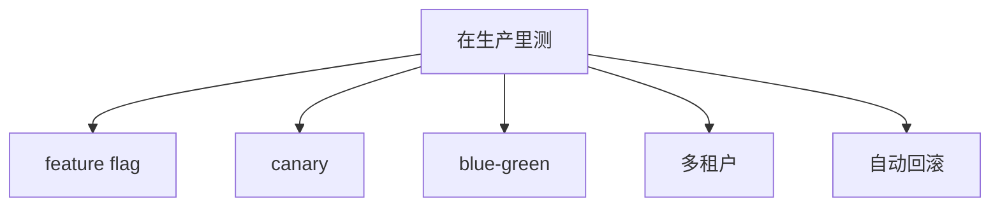

## Q
**Testing in production & specialised testing · 在生产里测，还有哪些专项测试**｜原则 · 加分

你们的预发环境总和线上不一致，经常"预发通过、线上出事"。同事提议"干脆在生产环境里测"。这是不是胡闹？另外，除了单元和集成测试，还有哪些专项测试？

## A
**原则：** 在生产里测试**做对了不是鲁莽**：它比预发环境更可信，但需要基础设施和合规保护。专项测试（performance、load、chaos、smoke）针对单元测试覆盖不到的风险。

**怎么做：**
1. **安全地测（五种）：** feature flag 先对测试开；canary 先给小部分用户；blue-green 两套环境，部署到空闲一套测完再切流量；canary 或 blue-green 配合监控自动回滚；multi-tenancy 让请求带租户上下文，服务识别是生产、测试还是 beta 租户（例如支付服务对测试租户用 mock）。
2. **好处：** 更有信心；更容易调试；环境更少，基础设施更简单。
3. **挑战：** 要投入基础设施（迁移到多租户可能漫长）；合规：测试不等于工程师能看到用户 PII，要有工具保证遵守隐私法规。
4. **专项测试：** performance test 测延迟和响应，难做好（其他进程、不确定性、机器差异）；load test 测在特定负载下的表现，如黑五约 10 倍流量，可用专门的测试设施、批处理生产请求、或用 1/10 的基础设施承担当前流量；chaos test 随机杀实例与服务，验证失败时能否继续（Netflix 的 Chaos Monkey）；smoke test 快速检查关键功能。
5. **按风险选：** 不是都要上；先从最高风险处。

**常见错法：**
- **没有隔离就直接在生产测：** 影响真实用户。
- **忽略隐私：** 测试时看到真实用户数据。
- **性能测试结论不可比：** 不同机器、不同时间。

**回到题目：** 不是胡闹：先用 feature flag 和 canary 在生产测，配监控和自动回滚；逐步向多租户演进；对关键路径加 load test 和 smoke test；调试要遵守隐私规则。

面试官看什么 · 配哪类故事 · 出处

**面试官在考什么：** 你对测试环境、风险和合规的综合判断。

**适合配哪类故事：** 你引入了生产中的安全测试（canary、flag）或专项测试，抓到了预发环境发现不了的问题的经历。

**出处：** Orosz《The Software Engineer's Guidebook》ch14 §5 "Specialized Tests"（Performance、Load、Chaos、Smoke）、§6 "Testing in Production"（approaches、benefits、challenges）

