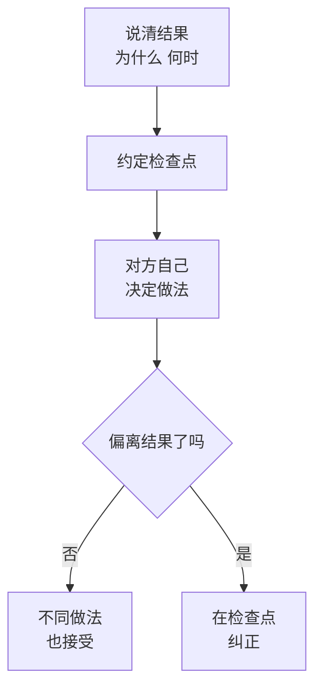

## Q
**Delegation · 交付结果，不是步骤**｜原则 · 必会

你是项目的技术负责人，把一个重要模块交给了一位中级同事。过了几天你发现他的做法和你不一样，你忍不住把任务拿回来自己做了。后来同事不再主动找你商量事情。你该怎么重新做好 delegation？

## A
**原则：** 授权时交付**结果**（要达成什么、为什么、什么时候），不是一步步的做法；设**检查点**；并**接受别人做得和你不一样**。把活收回来会让别人觉得你不信任他。

**怎么做：**
1. **说清结果：** 目标、背景、成功标准、截止日期，让他清楚"做成什么样"。
2. **让掌握信息最多的人决定：** 具体做法由他拿主意，你帮他把想法说出来并支持。
3. **设检查点：** 约好什么时候、看什么，比事后发现偏离更早。
4. **做得不同也可以：** 只要达成结果，不必和你的做法一样。
5. **向上、向侧、向下授权：** 也可以把工作交给经理或支持你的同事；给团队成员领导机会，要看他们想不想要。
6. **仍对结果负责：** 授权不等于撒手。

**常见错法：**
- **把任务拿回来：** 破坏信任，别人以后不再找你。
- **只给步骤：** 对方成了执行者，不能成长。
- **完全放手没检查点：** 偏离了才发现。
- **所有决定自己做：** 技术负责人容易以为该决定的事都归自己；信息最多的往往是做事的人。

**回到题目：** 向同事道歉并还给他；重新约定：结果是什么、什么时候做第一次检查、哪些风险随时来聊。他的做法只要达到目标就接受，如有顾虑在检查点以提问的形式提出。

**面试官在考什么：** 你有没有扩展团队产能的能力，而不是所有事都自己做。

**适合配哪类故事：** 你把一个重要工作交给别人，通过检查点保证结果，并看到对方因此成长的经历。

**出处：** Orosz《The Software Engineer's Guidebook》ch16 §5 "Day-to-Day Project Management"（Delegate generously；"Consider empowering the person with the most information to decide"）；ch22 §1（"Distrusts other engineers" 一段）；Part IV 引言
