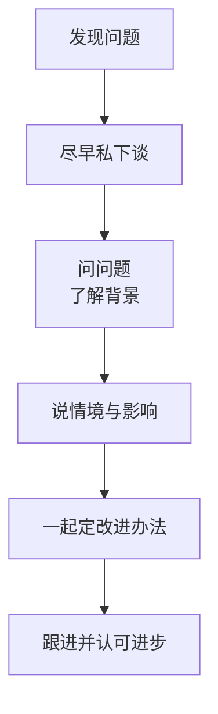

## Q
**Hard feedback · 尽早、具体、可改变**｜原则 · 加分

你带的一位中级工程师连续两个 PR 都没写测试，评审也经常延期。你一直没说，因为他刚入职不久。现在已经过去两个月，马上要做季度评估。你怎么办？

## A
**原则：** 难的反馈越早越好，**具体、基于可观察的行为、对方能改变**。拖到评审季才说，对方只会想"为什么不早告诉我"。

**怎么做：**
1. **别等：** 经理欠下属尽早反馈；评估时才提几个月前的事，会让人愤怒。
2. **先提问：** "你想过怎么测试这个改动吗？"对方可能有紧急修复、遗忘或不知道规范；提问给了他补充背景和自己纠正的机会。
3. **具体到行为：** 指出哪两个 PR、缺了什么、造成什么影响；不说"你不够认真"。
4. **共同找办法：** 先分享观察，再用问题引导他得出结论，得出后给予正面肯定；避免只发指令。
5. **站在对方一边：** 说明你想让他成为更好的工程师，沉默更容易。
6. **当面谈：** 不用邮件或聊天。
7. **以积极收尾：** 双方关系比刚谈完前更好。
8. **你是经理或不是：** 不是经理时，说明这只是观察；有行为持续不改变，让他的经理知道。
9. **跟进：** 一周后看改进了没有，做到了就明确认可。

**常见错法：**
- **憋到评估季。**
- **只说结论：** "质量不行"。
- **一上来就批评：** 没有了解背景。

**回到题目：** 今天就约他当面聊："这两个 PR 里没看到测试，我想听听你的想法。我们这里的规范是……我可以怎么帮你？"一周后回看；评估时就不会有意外。

**面试官在考什么：** 你有勇气尽早说，也有技巧让对方愿意听。

**适合配哪类故事：** 你及时给了一次难的反馈，对方因此改变并成长的经历。

**出处：** Orosz《The Software Engineer's Guidebook》ch12 §4 "Giving Feedback"（Ask questions before jumping in；Deliver corrective feedback empathetically）；ch3 §2 "The Power of Habit"（"Ask for specific feedback, every now and then"：managers owe it to their reports to share feedback as soon as possible）；ch2 §4
