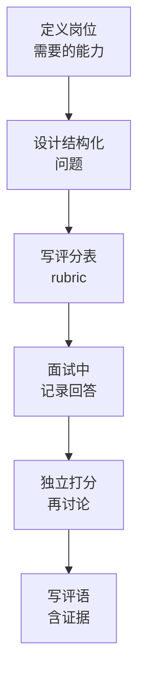

## Q
**Interviewing others · 结构化面试**｜原则 · 必会

你们招后端工程师，几个面试官各问各的，评语常常是"感觉不错"或"沟通一般"，最后开会各说各话。你被请来改进面试流程，怎么做？

## A
**原则：** 用**结构化面试**：先定义岗位真正需要的能力，所有候选人回答同样的、与岗位相关的问题，用同一把评分尺打分，并写下具体证据。这样面试官少凭感觉，比较才公平。

**怎么做：**
1. **先定义能力：** 成功做好这个岗位需要哪些具体属性，而不是"感觉合不合适"。
2. **设计问题：** 与岗位相关、经过验证、每位候选人同样问；不问脑筋急转弯。
3. **评分表（rubric）：** 对每个问题事先写好"什么样的回答算好、一般、不够"，用共同的尺度打分。
4. **记录：** 面试时详细记录候选人的回答，让之后的评审者能看到原始证据。
5. **评语写证据：** 写"他说了什么、做了什么"，而不是"我觉得他很聪明"。
6. **避免偏差：** 先各自独立打分，再讨论；对所有候选人同一把尺。

**常见错法：**
- **各问各的：** 没法比较。
- **凭印象和"感觉"：** 容易受相似背景、表达风格等偏差影响。
- **评语没有证据：** 讨论时只能比嗓门。
- **问过时或不相关的难题：** 测的是运气，不是工作能力。

**回到题目：** 先和团队写下这个岗位的 几条能力，每条配一个问题和一张评分表；统一记录模板；面试后先提交独立评分和证据，再开评审会，会上对照评分表讨论。

**面试官在考什么：** 你是否能设计公平、可重复的评估流程，而不只是"我会面试"。

**适合配哪类故事：** 你设计或改进过面试流程（问题库、评分表），让团队的招聘判断更一致的经历。

**出处：** Google re:Work《Use structured interviewing》（rework.withgoogle.com/en/guides/hiring-use-structured-interviewing：定义岗位属性、经过验证的相关问题、记录回答、按预定标准统一评分）
